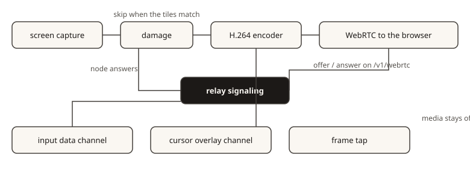
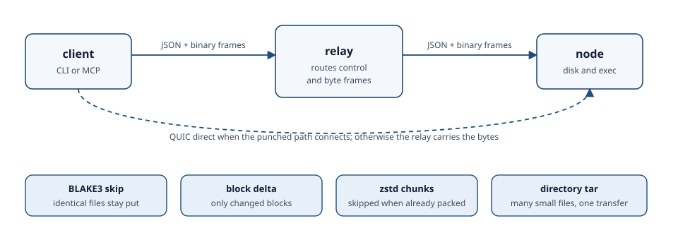
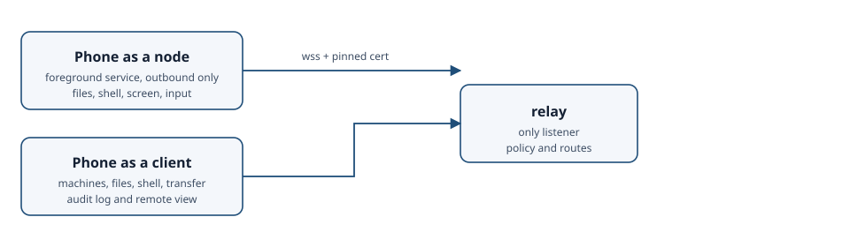
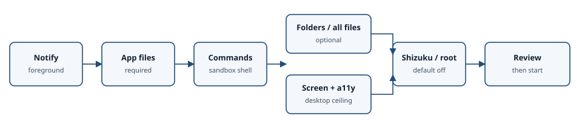
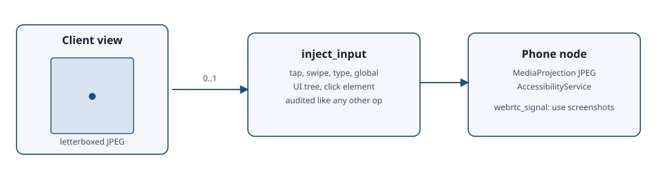

# agentlink

agentlink lets an AI agent, or you, use a Linux, Windows, or macOS machine that is sitting behind NAT. Each machine runs one small daemon. The daemon dials out to a relay you host. A single `agentlink` binary is the relay, the node, the CLI, and an MCP server.


The relay is the only process that listens on a port. Nodes and clients both make outbound connections, so a machine behind NAT does not need a port forward.

Accounts, device login, sharing, and the browser Add-machine page are described in [docs/multi-user.md](docs/multi-user.md). SQLite is the default database and PostgreSQL is selected with `AGENTLINK_DATABASE_URL`; see [docs/deploy.md](docs/deploy.md). `agentlink login --user` is the same password flow the Android app uses. After that login, Act as node enrolls the phone under the account without a pairing token.

## What phase 1 does

- File operations: stat, list, read, write, mkdir, remove, move. `cat`, `write`, `cp`, and the MCP file tools use the fast path below. `cat` streams to stdout and `write` streams from stdin.
- Content search (regex or literal, glob include/exclude, `.gitignore`) and filename search.
- Precise edits: exact replace, line-range edit, and unified diff apply, written atomically.
- Filesystem watches. The CLI follows events; MCP polls them.
- Commands with streaming stdout and stderr, an exit code, a timeout, and cancel. Timeout and cancel kill the process group, including grandchildren.
- Background processes: start, list, incremental output, status, and kill.
- System info: OS, CPU, memory, disks, user, shell, a filtered environment, and detected tools.
- An interactive PTY (`portable-pty`, including Windows ConPTY). `agentlink shell` uses raw mode and resize when the local stdin is a terminal.
- Pairing with an ed25519 node key and a one-time token.
- TLS with a pinned self-signed certificate. There is no unauthenticated mode.
- A signed-in owner, admin, or sharee has full access: files, shell, and desktop. Presets are not a cap.
- A tamper-evident JSONL audit log on the node, with optional relay and S3 sinks. Handlers call `audit::submit(AuditEvent)`.
- `agentlink mcp` on stdio for Cursor and Claude Desktop.

Phase 2 is screenshots, pointer and keyboard input, and the accessibility tree. A sealed client can use them after the node has a grant for that client's key. An account login is not that grant.

## Remote desktop

Phase 3 is a live desktop for a sealed client. Picture bytes go peer-to-peer after the node accepts a grant for that client. The browser does not open a desktop. `agentlink view` fails, and `GET /view` only says that browser control is not available.



A node reports whether it has a graphical session. A headless machine, such as a Linux server with no `DISPLAY` or `WAYLAND_DISPLAY`, has no desktop stream. The node also asks for consent before it answers an offer:

| `--stream-consent` | Behavior |
| --- | --- |
| `notify` (CLI default) | Allow, and try a non-blocking notification (`notify-send`, `osascript`, or PowerShell) |
| `auto` | Allow with no notification |
| `prompt` | Wait up to 30 seconds for `<data>/stream-consent/<id>.allow` or `.deny` |
| `deny` | Reject every offer |

A node library that never calls `configure_stream` denies offers. The CLI calls it.

Sessions append `stream_start` and `stream_stop` to the node `audit.log` (RFC3339 time, viewer, duration, frames, bytes). SDP is not logged. A `ScreenRecorder` in another crate can subscribe with `register_frame_tap` and receive `Started`, `Frame` (shared BGRA pixels plus dirty rectangles), and `Stopped`. This crate does not define `ScreenRecorder`. Capture stops when the last viewer leaves. Unchanged 64×64 tiles are not encoded.

### Capture

| OS | Session |
| --- | --- |
| Windows | DXGI Desktop Duplication. A timeout with no new frame is treated as unchanged. One-shot screenshots still fall back to GDI. |
| macOS | ScreenCaptureKit, cursor not composited. One-shot screenshots stay on CoreGraphics. If ScreenCaptureKit fails, the session falls back to repeating `CGDisplayCreateImage`. |
| Linux X11 | XShm. XDamage + XFixes when the server has them; otherwise tile hashes still drop a static desktop. |
| Linux Wayland | Screenshot portal. A build that found `libpipewire-0.3` headers also maps the ScreenCast stream (dma-buf is copied once into BGRA). Set `AGENTLINK_DESKTOP_PIPEWIRE=0` to stay on the portal. Xvfb has no Wayland session, so CI does not open a portal dialog. |

`frame_interval` for audit recorders stays capped at 30 fps. Streams use `stream_interval`, capped at 60.

### Encode

Hardware first, in process where the OS allows it: VideoToolbox on macOS, a Media Foundation hardware transform on Windows (NVENC, Quick Sync, and AMF show up there). On Linux, ffmpeg is used for NVENC, QSV, VAAPI, or AMF only when the device node exists (`/dev/nvidia0` or `/dev/dri/renderD128`). A ffmpeg build that merely lists `h264_nvenc` is skipped. The in-process software encoder is minih264 (public domain, baseline, no B-frames). It is not Cisco OpenH264. When ffmpeg is installed, libx264 `ultrafast` / zerolatency and libvpx-vp9 are further fallbacks, and H.265 / AV1 use the matching ffmpeg encoder when one is present. Bitrate follows loss reports from the viewer, clamped between 200 kbps and 8 Mbps. A keyframe can be requested. Resolution is not changed mid-session.

### NAT

Host candidates are enough on a LAN. For a viewer on another network, run [coturn](https://github.com/coturn/coturn) yourself. agentlink does not embed a TURN server and the relay does not terminate TURN.

```
listening-port=3478
tls-listening-port=443
fingerprint
use-auth-secret
static-auth-secret=replace-with-AGENTLINK_TURN_SECRET
realm=agentlink
# Cap abuse if a short-lived credential leaks.
max-bps=2000000
bps-capacity=4000000
user-quota=2
total-quota=50
```

Prefer `turns:` on 443 (`turns:turn.example:443?transport=tcp`) so the media relay is TLS on a port that is usually open. Keep a public STUN server if you want reflexive candidates. The shared secret is `AGENTLINK_TURN_SECRET` on the relay, the same value as coturn `static-auth-secret`. Do not put a long-lived TURN password in the relay environment. `AGENTLINK_TURN_USERNAME` and `AGENTLINK_TURN_PASSWORD` are obsolete. Any password that was ever returned by unauthenticated `GET /view/config.json` is compromised: rotate it when you switch coturn to `use-auth-secret`, and do not reuse it as the REST secret.

On the relay process, set TURN when the viewer is across a symmetric NAT. STUN has a default: if `AGENTLINK_STUN_URLS` is unset, `/view/config.json` lists public STUN servers (`stun:stun.l.google.com:19302`, `stun:stun1.l.google.com:19302`, and `stun:stun.cloudflare.com:3478`). Set the variable to replace that list. Set it to an empty value for host candidates only. TURN URLs are never filled in by default, and that public document never includes a username or credential.

```bash
AGENTLINK_STUN_URLS=stun:turn.example:3478
AGENTLINK_TURN_URLS=turns:turn.example:443?transport=tcp
AGENTLINK_TURN_SECRET=replace-with-the-coturn-static-auth-secret
# optional, clamped to 5–15 minutes (default 600)
AGENTLINK_TURN_TTL_SECS=600
```

`GET /view/config.json` is unauthenticated and lists STUN plus TURN URLs only. `POST /api/ice` mints a TURN REST credential (`username` is `<expiry unix>:<user>`, `credential` is base64 HMAC-SHA1 of the secret) for a logged-in dashboard session or a valid view ticket, and refuses everyone else. The browser sends those servers on the offer. The node uses the same list when an offer arrives without ICE servers. The phone viewer gathers host candidates plus the default public STUN list, or `AGENTLINK_STUN_URLS` when that variable is set. It does not yet read `/view/config.json`, so a phone off the LAN needs its own short-lived TURN credentials when STUN cannot punch through. The page Connection menu is Auto or Relay only. Auto tries host, then each STUN server, then TURN UDP, then TURN TCP, and gives up on a server that does not answer within a few seconds. Relay only gathers TURN candidates (`iceTransportPolicy: relay`, the Force TURN path). The banner shows the path that connected (`via host`, `via STUN`, `via TURN udp`, `via TURN tcp`). If every path fails, or the node refuses the offer, the page polls a JPEG screenshot about once a second. That fallback is the sealed `screenshot` invoke, not an RTP frame. A screenshot the node denies stays as that error instead of a black video element.

Live video and audio are WebRTC media: DTLS-SRTP between the browser (or the phone viewer) and the node. That is not the agentlink end-to-end payload cipher. Signaling, input when it goes through the relay, and the JPEG fallback stay on the sealed invoke path.

### Audio

Audio is optional G.711 µ-law (PCMU, 8 kHz, mono). On Linux the node shells out to `pw-record` or `parecord` when one of them is on `PATH`. If neither is there, the session stays video-only.

### What a 640×360 stream costs

These numbers are one `cargo test --release -p agentlink-desktop --lib stream::bench` run on the Linux CI image. The frames are synthetic 640×360 BGRA. minih264 was the encoder (no GPU). CPU time comes from `/proc/self/stat`, which counts in 10 ms ticks, so the percentages are coarse. This is damage plus encode. It is not a browser decode and not a LAN round trip. WebRTC loopback latency was not measured here.

| Scene | Encoded | Bytes | Bitrate over the simulated second | CPU | First access unit |
| --- | --- | --- | --- | --- | --- |
| Static desktop, 30 frames | 1 | 977 | ~7 kbps (the keyframe; later frames send nothing) | 10 ms, about 1% of one core | 1 ms |
| Typing, 30 frames, one pixel moves | 30 | 1,976 | ~15 kbps | 20 ms, about 2% of one core | 1 ms |
| Noisy video, 20 frames | 20 | 408,358 | ~4.9 Mbps | 30 ms, about 4% of one core | 1 ms |

The page shows latency, fps, bitrate, codec, and encoder name (`stat-latency`, `stat-fps`, `stat-bitrate`, `stat-codec`, `stat-encoder`). The latency the page shows is the browser's WebRTC round-trip estimate, which this table does not include.

### Android viewer

The phone client is the other offerer on this same `webrtc_signal` contract. `agentlink-view` opens a recvonly H.264 peer connection and the data channels `input`, `cursor`, and `meta`. RTP is depacketized to Annex-B. Android `MediaCodec` decodes it and prefers a hardware AVC decoder (`OMX.google.*` and `c2.android.*` are the software fallback). Fullscreen, pinch, and pan use one viewport for the JPEG and the live surface. The live texture is letterboxed, then scaled and translated with that viewport. Touches stay in the unscaled frame and map through the zoom into remote pixels. Pointer, keyboard, and loss feedback use the `input` channel when it is open, in the same JSON the browser sends (pixel coordinates, not normalized taps). `inject_input` remains the path when that channel is closed, and Android global actions (back, home, recents, notifications) always use `inject_input`. The offer asks for 30 fps and 2 Mbps. The node already adapts bitrate between 200 kbps and 8 Mbps from `{type:feedback, loss}`. Resolution is not changed mid-session. A retry starts a new offer. `ice_restart` stays a node action the phone does not send.

Screenshot polling (one JPEG about every 700 ms) runs only when the offer is refused, the phone node reports `status: unavailable` / `fallback: screenshot`, no frame arrives within 8 seconds, or the connection fails. A static desktop sends nothing after the keyframe. That silence is not a failure.

Classic RDP remotes drawing orders, glyph and bitmap caches, and dirty rectangles. Later RDP codecs compress those rectangles, and input is a separate virtual channel. This path skips unchanged 64×64 tiles, so a static desktop is about one keyframe and then silence (the bench above is ~7 kbps, against a full JPEG several times a second). Changes are whole-frame H.264 P-frames, not glyph runs (the typing bench is ~15 kbps). Input and the cursor are separate channels. Still missing, compared with RDP: glyph and bitmap caches, drawing orders, dirty-rect-only encode, and 4:4:4 text. The phone viewer gathers host candidates plus the default public STUN list, or `AGENTLINK_STUN_URLS` when that variable is set. It does not yet read `/view/config.json`, so a phone off the LAN needs `AGENTLINK_TURN_*` (or a later config fetch) when STUN alone cannot punch through.

## Build

Rust 1.99 or newer.

```bash
cargo build
cargo test
```

The release binary is the one to copy onto machines:

```bash
cargo build --release
# target/release/agentlink
```

Tests run locally with `cargo test`. This repository does not include GitHub Actions workflows.

## Run a relay

On a host that clients and nodes can reach:

```bash
agentlink relay --bind 0.0.0.0:7443
```

The process prints the listen address and certificate fingerprint, and stores them under the relay data directory (by default the OS data dir, `agentlink/relay`). The admin token is printed only on the start that creates it. Later starts print the path of `admin.token` instead of the secret, so a restart does not copy the token into the journal. `--print-admin-token` prints it again.

Keep the admin token private. A self-signed relay is pinned with `sha256:…`. That pin is not a secret: clients refuse any certificate that does not match it. The generated certificate is reused, so the pin stays stable. A public certificate (Let's Encrypt rotates the leaf every 60–90 days) should be verified with `--trust webpki` or `--fingerprint system` instead of a leaf pin. See [docs/deploy.md](docs/deploy.md).

Open the relay port on that host only. Nodes do not listen.

The same relay runs in a container. `docker-compose.yml` publishes port 7443 and keeps the certificate and admin token in the `relay-data` volume:

```bash
docker compose up -d
docker compose logs relay
```

The image listens on `0.0.0.0:7443` and stores its state at `/var/lib/agentlink`. The process runs as the non-root user `agentlink`. A named volume is created with that user's ownership. A bind mount that is owned by root is not writable by the container. This image is a glibc Debian build. Linux release archives are separate static musl binaries.

On a host without Docker, `deploy/agentlink-relay.service` is a systemd unit for the same command. The comments in that file list the `useradd`, directory, and `systemctl enable` steps. The first start prints the fingerprint and admin token. Later starts print the path of `admin.token`. Putting the relay behind nginx on port 443 is described in [docs/deploy.md](docs/deploy.md): `wss://host` dials 443, and `wss://host:7443` still dials 7443.

There is no built-in relay. Pass `--relay` or set `AGENTLINK_RELAY`, plus `--fingerprint` or `--trust`. A saved `config.json` relay URL is kept and still dials. Installs that used to omit `--relay` because a host was compiled in must set the relay explicitly; this build does not substitute one. A relay restart is a blip: nodes, CLI commands, MCP calls, shells, watches, and copies reconnect without pairing again. See [docs/deploy.md](docs/deploy.md).

## Pair a machine

From a client that has the relay URL, token, and fingerprint:

```bash
agentlink login \
  --relay wss://relay.example:7443 \
  --token "$AGENTLINK_TOKEN" \
  --fingerprint "$AGENTLINK_FINGERPRINT"

agentlink pair --name laptop --access exec
```

`access` is `read-only` (the CLI default), `read-write`, `exec`, `desktop`, `remote-view`, `remote-control`, or `full`. `exec` includes read and write and leaves screenshots and the stream off. `desktop` adds screenshots, input, and the accessibility tree on top of `exec`. It does not enable `allow_desktop_stream`. `full` is shell, files, and remote desktop together. The browser form defaults to `exec` for a machine whose screen is not known yet.

A signed grant is full use only up to the node's own `--max-access` ceiling. `agentlink node --max-access exec` still refuses screenshots and desktop input after a grant. The relay pairing preset does not authorize the machine and cannot raise that ceiling.

On the machine you want to control:

```bash
agentlink node \
  --relay wss://relay.example:7443 \
  --fingerprint "$AGENTLINK_FINGERPRINT" \
  --pairing-token "$TOKEN" \
  --name laptop
```

The node writes an ed25519 key into its data directory and reconnects with that key. Later starts do not need the pairing token. The token works once.

Optional limits on the node:

- `--max-access read-only` is the node's ceiling. A signed grant is intersected with it. The relay cannot raise it.
- `--root /path` confines file operations to that directory, including a check that symlinks do not escape it. The same root is the default working directory for exec, background processes, and PTY sessions, and an explicit cwd is resolved inside it. It is not an OS sandbox: a program still runs as the user who launched the node.

`agentlink perm laptop read-only` changes only the relay's routing preset. It does not change what the node will run.

## Install a node


Release archives, when you build them yourself, are named:

- `agentlink-<version>-x86_64-unknown-linux-musl.tar.gz` and the `aarch64` musl archive
- `agentlink-<version>-x86_64-pc-windows-msvc.zip` and the `aarch64` zip
- `agentlink-<version>-x86_64-apple-darwin.tar.gz`, the `aarch64` archive, and `agentlink-<version>-universal-apple-darwin.tar.gz`
- `SHA256SUMS` over those archives

Linux and macOS:

```bash
curl -fsSL https://raw.githubusercontent.com/zltl/agentlink/main/install.sh | sh -s -- \
  --relay wss://relay.example:7443 \
  --fingerprint "$AGENTLINK_FINGERPRINT" \
  --token "$AGENTLINK_TOKEN" \
  --name laptop
```

Windows PowerShell. `iex` does not forward arguments, so the relay, fingerprint, and token are environment variables:

```powershell
$env:AGENTLINK_RELAY = "wss://relay.example:7443"
$env:AGENTLINK_FINGERPRINT = "sha256:..."
$env:AGENTLINK_TOKEN = "..."
irm https://raw.githubusercontent.com/zltl/agentlink/main/install.ps1 | iex
```

`--token` is the relay admin token. The installer uses it to mint a one-time pairing token and writes that token into the node data directory. The service definition does not contain it. After the node enrolls, the token is removed from `node.json`. Pass `--pairing-token` when `agentlink pair` already minted one. The relay preset defaults to `read-only`.

The script always checks `SHA256SUMS` and `SHA256SUMS.minisig`. The public key is the copy pinned in the script (the same material as `deploy/minisign.pub`). It is not downloaded from the release host. `AGENTLINK_UPDATE_PUBKEY` may point at a local file or paste the key text. The install scripts call `minisign` and stop if it is missing or the signature does not verify. `AGENTLINK_CHECKSUM_ONLY=1` is the only way to skip the signature. `agentlink update` verifies the signature itself with the key embedded at build time and does not need the `minisign` program.

Releases are signed when the `AGENTLINK_SIGNING_KEY` repository secret is a 32-byte ed25519 seed in hex. The workflow then uploads `SHA256SUMS.minisig` and `minisign.pub`. That published public key is not a trust root. A missing or bad signature is a failure unless checksum-only was requested.

User scope installs the binary under `~/.local/bin`, or `%LOCALAPPDATA%\agentlink`. System scope uses `/usr/local/bin`, or `%ProgramFiles%\agentlink`, and needs an administrator. `--scope system`, `--auto-update`, and `--headless` are optional.

## Background service

```bash
agentlink service install \
  --relay wss://relay.example:7443 \
  --fingerprint "$AGENTLINK_FINGERPRINT" \
  --token "$AGENTLINK_TOKEN" \
  --name laptop

agentlink service status
agentlink service stop
agentlink service start
agentlink service uninstall
```

`--scope user` is the default, because a later desktop phase has to run in the user's GUI session:

- Linux: a systemd user unit (`systemctl --user`) wanted by `graphical-session.target`. It starts with the graphical session and stops when that session ends (`PartOf=`). `PassEnvironment` forwards `DISPLAY`, `WAYLAND_DISPLAY`, `XAUTHORITY`, `DBUS_SESSION_BUS_ADDRESS`, and `XDG_RUNTIME_DIR` from the user manager. Install runs `systemctl --user import-environment` for whichever of those are set in the current shell, then restarts the node. `~/.config/autostart/agentlink-node.desktop` does that again at graphical login, and it also starts the node on a desktop that never reaches `graphical-session.target`. `--headless` is wanted by `default.target` instead, with no GUI variables and no autostart entry. The user service stays down until that user's service manager is up.
- macOS: a LaunchAgent limited to the Aqua session. `--headless` drops that limit. `--scope system` is a LaunchDaemon and stays outside the GUI session.
- Windows: the tray in the signed-in session. `agentlink tray` puts an icon in the notification area and opens a small window (relay connection, account and pairing, start-on-login). Start-on-login is an HKCU `Run` value, or a Startup-folder script if that value cannot be written. It does not use a scheduled task and does not need an administrator. `agentlink service install` (the default user scope) registers that autostart and launches the tray. `--scope system` is still a Windows service in session 0. Session 0 cannot drive the desktop. `--headless` does not remove the tray.

`--scope system` on Linux and macOS needs `--run-as`, or it uses `SUDO_USER`. Do not install user scope as root. `agentlink service install --dry-run` prints the unit and a redacted `node.json` and does not contact the relay. `--auto-update` also installs a daily task that runs `agentlink update --yes`.

## Windows tray

```powershell
agentlink tray
agentlink tray install
agentlink tray status
agentlink tray uninstall
```

`tray` with no subcommand opens the status window and a notification-area icon. Closing the window leaves the icon running. Quit is on the icon's right-click menu. `agentlink service stop` quits the tray.

The window shows whether the relay connection is online, connecting, offline, or stopped, and the relay URL. An empty saved relay stays empty (`relay not set`) until you pass `--relay` or `AGENTLINK_RELAY`. A saved URL and fingerprint, or `--trust`, are what the tray dials. Sign in with the account password (and an authenticator code when the account has one). A successful sign-in enrolls this computer under that account with the same `enroll_self` flow the phone uses, then reconnects. Paste an `agentlink-invite:v1:` string, or a pairing token, when someone else minted one with `agentlink pair`. Start, stop, and reconnect control the node loop. "Start when I sign in" writes HKCU `Run` for the current user. No administrator is required. A machine that should start at boot, before anyone signs in, still uses `agentlink service install --scope system`.

### How to verify on Windows

From a normal PowerShell window, not an elevated one:

```powershell
agentlink tray install --dry-run
agentlink tray
```

The dry run prints an `HKCU\Software\Microsoft\Windows\CurrentVersion\Run` command and does not call `schtasks`. The icon appears in the notification area. Click it. The window shows the relay, pairing, and account lines. Check "Start when I sign in", sign out of Windows, sign back in, and confirm the icon returns without an administrator prompt. Uncheck it, or run `agentlink tray uninstall`, and confirm the icon does not return at the next sign-in. `agentlink tray status` prints the same fields. Stop and Start in the window leave the icon up and change `running` in `agentlink tray status`.

`cargo test -p agentlink-cli --test tray_status` covers the status JSON and the dry-run text on every CI platform. The window itself is compiled in the Windows job (`cargo test --workspace` on `windows-latest`).

## Desktop controller

Windows, macOS, and glibc Linux builds include a controller window with the same jobs as the phone and the dashboard: sign in, the machine list, a shell, files, and remote desktop.

```bash
agentlink controller
agentlink controller --background
agentlink controller --check
```

Sign in is the account username and password. An authenticator code appears only when the account uses one. The relay URL, certificate pin, and trust stay under Advanced. Nothing is filled in until a relay URL is saved or passed.

Each machine has Terminal, Files, and Desktop. Desktop stays off on a headless machine. View opens the screen without keyboard or mouse. Control sends them, and it stays disabled unless the account grant includes remote-control. The picture is H.264 over WebRTC when the node offers it, and JPEG screenshots until the first decoded frame. The connection line says `host`, `stun`, `turn`, `quic`, or `relay`. The shell keeps the last 1000 lines.

Linux release archives are musl and do not include this window. Build it with the system C library:

```bash
cargo build -p agentlink-cli
./target/debug/agentlink controller
```

On a glibc Linux desktop, closing the window leaves a status icon when the session has a StatusNotifier tray. Open and Quit are on that icon. `--background` starts hidden, and the window comes back if the icon cannot start. Start on login writes `~/.config/autostart/agentlink-controller.desktop`. That entry opens the controller. It does not replace the node service. The Windows tray (`agentlink tray`) is unchanged and still starts the node for the signed-in user. On Windows, Start on login in this window is that same tray entry.

Live H.264 decode uses the OpenH264 decoder compiled into the glibc, macOS, and Windows builds. If that decoder does not start, the window stays on JPEG. `agentlink controller --check` prints `controller: ready` when the window is compiled in, and exits without opening it.

## Update this binary

```bash
agentlink update --check
agentlink update --yes
agentlink update --auto
agentlink update --disable-auto
```

`update` reads GitHub Releases for `zltl/agentlink` (`--repo` or `AGENTLINK_REPO`), downloads the archive for this machine, and checks `SHA256SUMS`. macOS prefers the universal archive. The public key is the build-time pin from `deploy/minisign.pub`, unless `--pubkey`, `AGENTLINK_UPDATE_PUBKEY`, or `update.json` names another local key. The updater does not download `minisign.pub` from the release or the mirror. A bad or missing `SHA256SUMS.minisig` is a failure. `--checksum-only` skips the signature. A terminal asks before replacing the binary. A non-interactive run needs `--yes`. `--version` installs that release even when it is not newer.

`--auto` only installs the daily timer. It does not download a release in that same run. The timer uses `--scope` (default user) and must be allowed to write the binary it runs.

On Unix the new file replaces the running binary by rename and leaves `agentlink.old` beside it. An active node service is restarted. On Windows the running `.exe` stays locked, so the updater writes `agentlink.exe.new`, starts a detached helper, and exits. The helper moves the file into place and restarts the service. If the helper fails, `agentlink.exe.new` is left behind.

`update` replaces the binary returned by `current_exe()`. A service that points at a different path keeps the old copy. There is no Authenticode signature and no Apple notarization, so SmartScreen and Gatekeeper can prompt on first launch.

## CLI

Commands that talk to a node use the saved login, or `--relay`, `--token`, and `--fingerprint`. `--json` prints one JSON document on stdout. Add `--json` for agents.

```bash
agentlink ls                              # paired machines
agentlink ls laptop /tmp                  # directory on a node
agentlink exec laptop -- uname -a         # program + args
agentlink exec laptop --shell -- 'echo hi && uname -a'
agentlink cat laptop /etc/hostname
agentlink write laptop /tmp/note.txt --content "hello"
agentlink cp ./local.txt node://laptop/tmp/local.txt
agentlink cp node://laptop/tmp/local.txt ./local.txt
agentlink mkdir laptop /tmp/demo --parents
agentlink rm laptop /tmp/note.txt
agentlink mv laptop /tmp/a /tmp/b
agentlink shell laptop                    # raw PTY when stdin is a terminal
agentlink shell laptop --line            # line-oriented fallback
agentlink search laptop 'fn main' . --include '*.rs'
agentlink find laptop '*.rs' .
agentlink replace laptop note.txt 'old text' 'new text'
agentlink edit-lines laptop note.txt 1 3 $'replacement\n'
agentlink patch laptop /tmp --file change.diff
agentlink watch laptop /tmp --timeout-secs 30
agentlink bg laptop start --shell -- echo hello
agentlink bg laptop list
agentlink sysinfo laptop
agentlink screenshot laptop --out screen.jpg
agentlink screenshot laptop --target region --x 0 --y 0 --width 200 --height 100 --format png
agentlink click laptop 100 200
agentlink click laptop 10 10 --to-x 80 --to-y 40
agentlink type laptop "hello"
agentlink key laptop ctrl+c
agentlink scroll laptop --dy 3
agentlink ui-tree laptop
agentlink client create bot --out ./bot.identity.json
agentlink client grant <id> laptop read-only
agentlink approve list
agentlink audit query --sink local --op exec --verify
agentlink audit config set capture.diff true
agentlink audit sink add bucket --kind s3 --data logs,recordings \
  --endpoint http://127.0.0.1:9000 --bucket audit --path-style --credentials env
agentlink ui-act laptop mock:ok --op click
```

`agentlink exec` exits with the remote status code. In `--json` mode the command's stdout is inside the JSON document, not mixed with it.

`node://laptop/tmp/a` means the absolute path `/tmp/a`. A Windows path keeps its drive: `node://laptop/C:/Users/me/a.txt`.

## Fast transfer

`agentlink cp` copies a file or a directory. It also copies from one node to another.

```bash
agentlink cp ./project node://laptop/tmp/project
agentlink cp node://laptop/tmp/project ./project
agentlink cp node://laptop/tmp/a.bin node://desktop/tmp/a.bin
agentlink cp ./big.bin node://laptop/tmp/big.bin --no-direct --compress off
```



What the copy does:

- Control messages stay JSON. File bytes are WebSocket binary frames, 1 MiB by default (`--chunk-size`, 64 KiB to 4 MiB).
- A sliding window (`--window`, default 8) keeps several chunks in flight, striped across ranges (`--parallel`, default 4). Each chunk carries its offset, so a transfer can resume from `.{name}.agentlink-partial` beside the destination.
- BLAKE3 skips a file that is already identical. A changed file at least 128 KiB sends an rsync-style block delta (Adler32 plus a BLAKE3 prefix) instead of the whole file. Files larger than 256 MiB are sent whole.
- Chunks are zstd when that shrinks them (`--compress auto|on|off`). Auto leaves images, archives, video, and other already-compressed types alone, and stops trying after an incompressible chunk.
- A directory is one tar stream of the files whose hashes differ, then unpacked on the destination.
- The client tries a direct QUIC connection first. The relay exchanges addresses and a hole-punch packet; the node’s ed25519 key signs the QUIC certificate, and the dialer signs the session. `--no-direct` stays on the relay. If the direct dial fails, the bytes fall back to the relay.

`--progress` (`auto`, `on`, or `off`; `--progress` alone is `on`) prints bytes done / total, percent, throughput, and ETA on stderr. `auto` does that while stderr is a terminal, as one updating line. `on` forces it, using a new line about twice a second when stderr is not a terminal. `off` stays quiet. Directory copies show overall progress of the archive stream. `--json` writes only the final JSON object to stdout; progress, when shown, stays on stderr.

The MCP tool `copy_path` takes `direction` (`upload`, `download`, or `peer`), `node`, `path`, and `local` or `dst_node` plus `dst_path`.

`cat` and `write` use the same frames, window, zstd, and QUIC-or-relay path. `cat` writes stdout as each in-order chunk arrives, holding at most one window of chunks to put a reordered burst back in sequence. `cat --json` stops after 1 MiB and sets `truncated`. `write` reads stdin or `--content` one chunk at a time and sends the BLAKE3 hash at EOF, so a pipe is not stored first. A streamed upload does not resume and does not send a block delta. MCP `read_file` transfers only `offset..offset+max_bytes` (default 1 MiB) and encodes that slice as text or base64 in the tool result. MCP `write_file` sends its argument through the same stream.

## MCP

`agentlink mcp` speaks newline-delimited JSON-RPC on stdin/stdout. It also accepts a `Content-Length` header on input. Logs go to stderr. `agentlink mcp --http 127.0.0.1:7337 --mcp-token "$AGENTLINK_MCP_TOKEN"` serves the same messages on `POST /mcp`, with `GET /mcp` as an SSE keepalive and `DELETE /mcp` ending the session. Bearer auth is required. An `Origin` header must be localhost.

Cursor (`~/.cursor/mcp.json` or `.cursor/mcp.json`):

```json
{
  "mcpServers": {
    "agentlink": {
      "command": "/absolute/path/to/agentlink",
      "args": ["mcp"],
      "env": {
        "AGENTLINK_RELAY": "wss://relay.example:7443",
        "AGENTLINK_TOKEN": "paste-admin-token",
        "AGENTLINK_FINGERPRINT": "sha256:paste-fingerprint"
      }
    }
  }
}
```

Claude Desktop uses the same shape. The file is:

- macOS: `~/Library/Application Support/Claude/claude_desktop_config.json`
- Windows: `%APPDATA%\Claude\claude_desktop_config.json`
- Linux: `~/.config/Claude/claude_desktop_config.json`

You can `agentlink login` instead of env vars if the MCP process runs as the same user and can read the config file. Env and flags win over the file.

Tools:

| Tool | Purpose |
| --- | --- |
| `list_machines` | Paired nodes, online flag, effective policy |
| `list_dir` | Directory listing |
| `stat_path` | One path |
| `read_file` | Fast-path byte range. UTF-8 when the bytes are text, otherwise base64, and only in the tool result. `offset` and `max_bytes` page large files (default 1 MiB) |
| `write_file` | Fast-path upload of `content` or `content_base64` |
| `mkdir` | Create a directory |
| `remove_path` | Delete a file or, with `recursive`, a tree |
| `move_path` | Rename on the same node |
| `copy_path` | File or directory upload, download, or node-to-node copy |
| `run_command` | `command` (shell) or `argv` (no shell). Output is capped at 1 MiB |
| `search_content` | Regex or literal content search, with globs, context, and pagination |
| `search_files` | Filename glob or regex |
| `replace_text` | Exact replace. Fails unless the match is unique or `replace_all` is set |
| `edit_lines` | Replace a 1-based inclusive line range |
| `apply_patch` | Unified diff, relative to `root` |
| `watch_start` / `watch_poll` / `watch_stop` | Filesystem events. Poll because MCP is request/response |
| `process_start` / `process_list` / `process_output` / `process_status` / `process_kill` | Detached commands. Kill stops the process group |
| `system_info` | OS, CPU, memory, disks, user, shell, filtered env, detected tools |
| `terminal_open` / `terminal_write` / `terminal_read` / `terminal_resize` / `terminal_close` | Poll-based PTY |
| `screenshot` | Image content plus a short summary. `target` is `screen`, `monitor`, `region`, `window`, or `monitors`. `format` is `jpeg` (default), `png`, or `webp` |
| `click` | Move, click, or drag (`to_x` / `to_y`, or `move_only`) |
| `type` | Unicode text |
| `key` | A combo such as `ctrl+c` |
| `scroll` | Positive `dy` scrolls up |
| `get_ui_tree` | Compact accessibility tree: role, name, bounds, id |
| `act_on_element` | `click`, `focus`, or `set_value` on an id from the tree |

`run_command`, `process_*`, and `terminal_*` are rejected unless the node's effective policy includes exec. Search, watch, and `system_info` need read. Edits need write. `screenshot` is allowed when the effective policy has `allow_desktop` or remote view. `inject_input` is allowed when it has `allow_desktop` or remote control.

## Security model

- Transport is TLS 1.2+ (rustls, ring). Clients pin the relay certificate's SHA-256, or verify it with the OS trust store (`--fingerprint system`) or Mozilla roots (`--trust webpki`). A leaf pin does not check the hostname, so a raw IP is fine. Public roots and an intermediate SPKI pin do check the hostname. `AGENTLINK_RELAY_PIN` is the same pin (`sha256:` or `spki:sha256:`) when you do not want it in the saved config. CA-only trust (`system` or `webpki` with no pin) is warned: a public CA does not bind a node name to its ed25519 id. See [docs/deploy.md](docs/deploy.md).
- The first successful node list pins each name to its ed25519 id in `node-pins.json` (the dashboard uses `localStorage` key `agentlink.nodePins`; the phone uses the same key in preferences). A later id for that name is refused until the pin file is edited on purpose.
- The admin token still works for automation. Comparison does not stop at the first differing byte. A hello that carries the token is an admin and may use the node's effective policy, up to the node ceiling. Prefer an account and TOTP. Set `AGENTLINK_LEGACY_ADMIN=0` to disable the file token, or `AGENTLINK_LEGACY_ADMIN_TTL_SECS` to expire it after creation. Every use is appended to the hash-chained audit log (`op` `legacy.admin`). Rotate `admin.token` after any exposure. Delete `bootstrap.password` after the first password change; the change itself removes the file. Do not pass `--print-admin-token` in a service unit.
- Agents are separate ed25519 identities. `agentlink client create` registers a public key. The agent connects with an empty token, answers `agentlink-auth-v1:<nonce>`, and only receives the grants an admin set with `agentlink client grant`. `agentlink client revoke` blocks the next handshake. The node id is still the node's public key.
- Unknown nodes are dropped unless they present a live, unused pairing token.
- Invoke, cancel, and relay-path transfer control are sealed to the node. The handshake is X25519 plus both ed25519 identities (a Noise-style transcript, not the Noise framework, because file chunks can be 4 MiB). After that, ChaCha20-Poly1305. The relay sees a coarse class (`read`, `write`, `exec`, `desktop`, `meta`) and routes on the request id. It does not see paths, command lines, or file bytes.
- Binary file frames keep the 40-byte header in the clear, including the request id and the file offset, so the relay can route them. The payload is encrypted. Set `FLAG_E2E` on those frames. QUIC copies are encrypted to the node certificate the node's ed25519 key signed; they are not wrapped a second time.
- Pin the node id when it matters. A relay that lies about which public key belongs to a display name can introduce a different peer. It cannot forge a signature for a key it does not hold. The client pins that mapping by default after the first successful connect, as above.
- The node is authoritative for the real operation. The relay's class check is a coarse filter. A malicious relay can stamp `relay_admin` or invent a grant name. The node ignores those stamps. Control requires a signature from a key in the node's `owner-keys.json`, over the E2E peer that opened the sealed body.
- Approval summaries and node-authored audit batches are cleartext on purpose. A person, and the relay query API, have to read them. Turn off `forward.central` when the relay must not store audit records. The node still writes its local chain.
- `--root` confines file paths and the working directory of exec, background processes, and PTY sessions. Command allow and deny globs (`--allow-cmd`, `--deny-cmd`, or `limits.json`) match the program name and the shell line. Deny wins. A missing `limits.json` is an empty allow list plus a deny preset for disk format, `dd` onto disks, shutdown, and shred. This is not an OS sandbox: there is no chroot, seccomp, Seatbelt, or Job Object. An allowed shell can run anything that user can run. Bubblewrap, seccomp, or a platform sandbox would be a separate program.
- `confirm.toml` can hold exec, remove, write, pty, or transfer until `agentlink approve allow` or `deny`. The timeout denies the operation. A missing file uses a baseline that holds `rm -rf`, `mkfs`, `dd` onto a disk, and power commands. Those holds are globs on the command summary, not a jail. Disk format and power commands are also on the default deny list, so approval does not make them run.
- WebRTC picture and audio bytes are DTLS-SRTP between the viewer and the node. They are not sealed with the agentlink payload key. JPEG screenshots stay on the sealed `screenshot` invoke. Force TURN is the viewer's Relay only mode.
- Browser view tickets are not issued. `GET /view` does not open a desktop.
- Login, refresh, signup, websocket connect, view-ticket mint, and `POST /api/ice` are limited per client IP.
- Desktop and WebRTC permissions exist on the policy struct and are denied unless both sides opt in.

### Audit

Handlers call `agentlink_node::audit::submit(AuditEvent)`. The node policy decides whether the event is stored. A failed audit write is logged and does not fail the operation. The legacy `audit.log` line (`op`, `detail`, `ok`) is still appended.

Each kept record is canonical JSON. The hash is BLAKE3 of `prev || newline || json-without-hash`. `agentlink audit query --verify` checks that chain. The same records verify after they are copied to the relay or to S3, because the hash does not depend on which sink stored the bytes. Concatenate objects in `seq` order and call `verify_chain`.

Sinks fan out. Each sink lists the data it accepts: `logs`, `diffs`, `recordings`, or all three. Configure them in `audit.toml` or with `agentlink audit sink add|ls|rm`.

| Kind | What it stores |
| --- | --- |
| `local` | `data_dir/audit/logs/YYYY-MM-DD.jsonl`, diffs and outputs under `audit/blobs/`, recordings under `audit/recordings/` |
| `relay` | Gzipped batches become hash-chain records in the relay's `audit.jsonl`. Query with `--sink relay`. The read-only page is `https://<relay>/audit` (admin token). |
| `s3` | Any S3-compatible API: AWS S3, MinIO, Cloudflare R2, Aliyun OSS, Tencent COS. Object key `{prefix}/{node_id}/{yyyy}/{mm}/{dd}/{kind}/{session}/{seq}.jsonl.gz` |

S3 settings on the sink: `endpoint`, `region`, `bucket`, `prefix`, `path_style`, `credentials` (`env`, `file`, or `iam`), `credential_file`, `profile`, `sse` (`AES256` or `aws:kms`), `client_key_env` (64 hex chars, AES-256-GCM before upload, magic `AGLKCSE1`). Env credentials are `AWS_ACCESS_KEY_ID`, `AWS_SECRET_ACCESS_KEY`, and optional `AWS_SESSION_TOKEN`. IAM uses the ECS relative URI or IMDSv2. A dead remote sink leaves a gzipped batch in `audit/spool/<sink>/` and retries with backoff. Retention days and `max_bytes` are per sink; S3 lifecycle deletes dated keys the node still knows about.

`agentlink audit query` reads `--sink local`, `--sink relay`, or `--sink s3`. Filters: `--node`, `--agent`, `--op`, `--since`, `--until`, `--text`. `--follow` prints new records. `--json` exports the page. `--verify` checks the chain.

Presets are `minimal`, `standard`, `full`, and `paranoid`. A file overlay, then a node override, then an agent override, apply on top. Agent wins. `lock_local` ignores a policy the relay pushes. `agentlink audit config show|set|preset` edits the file and appends an audit record for the edit. `--push <node>` also sends it live.

| Key | Meaning |
| --- | --- |
| `preset` | `minimal`, `standard`, `full`, `paranoid` |
| `lock_local` | Ignore `AuditPolicyPush` from the relay |
| `categories.<name>.enabled` | Record this category or skip it |
| `categories.<name>.detail` | `off`, `metadata`, `args`, `diff`, `output` |
| `capture.stdout_stderr` | Keep captured stdout and stderr |
| `capture.stdout_cap_bytes` | Cap per event, at most 16 MiB |
| `capture.pty_transcript` | Keep the PTY transcript |
| `capture.pty_cap_bytes` | Cap for that transcript |
| `capture.diff` | Store a unified diff for writes and edits |
| `capture.diff_cap_bytes` | Cap for that diff |
| `capture.hashes` | BLAKE3 of before and after bytes |
| `recording.mode` | `off`, `gui` (while a screenshot or input op is recent), `always` (while an agent has been active within `idle_secs`) |
| `recording.fps` | 1 to 30. The recorder loop clamps to that range |
| `recording.quality` | `low`, `medium`, `high` (pixel step 4, 2, 1) |
| `recording.per_session` | One segment per session id |
| `recording.idle_secs` | How long `gui` or `always` stays on after the last matching activity |
| `retention.log_days` | Delete local log files older than this |
| `retention.diff_days` | Delete stored diffs older than this |
| `retention.recording_days` | Delete recordings older than this |
| `retention.max_log_bytes` | Cap the log directory |
| `retention.max_diff_bytes` | Cap stored diffs |
| `retention.max_recording_bytes` | Cap recordings |
| `forward.central` | Upload the chain to the relay sink |
| `forward.chain` | Compute and require the hash chain |
| `redact.patterns` | Regexes replaced before args, diffs, and output are stored |
| `redact.env_keys` | Globs whose env values are redacted. Default covers `*SECRET*`, `*TOKEN*`, `*PASSWORD*`, `*KEY*`, `*CREDENTIAL*` |
| `paths.include` | If non-empty, only matching paths are recorded |
| `paths.exclude` | Skip the event. Defaults include `**/.ssh/**`, `**/*.pem`, `**/id_rsa`, `**/.aws/**`, `**/.gnupg/**` |

Categories: `file_read`, `file_write`, `edit`, `delete_move`, `transfer`, `search`, `watch`, `exec`, `background`, `pty`, `gui_screenshot`, `gui_input`, `a11y`, `desktop_stream`, `sysinfo`, `auth`, `permission`, `approval`.

Transfers record source and destination node and path, size, BLAKE3, direction, and `relay` or `quic`. Writes record the path, before and after hashes, and a unified diff unless the file is binary (NUL or non-UTF-8), larger than 1 MiB, or longer than 400 lines. Commands, background processes, and PTY sessions record the command line, cwd, env changes, exit code, duration, and captured output up to the cap. A PTY also writes a second record when the child exits.

Screen recording opens `CaptureBackend::open_session` on the same desktop backend as the screenshot handler and pulls `FrameSource::next_frame`. Frames are BGRA from the platform and stored as RGBA. Segments use magic `AGLKREC1`: a deflate keyframe every 10 frames and 32×32 changed tiles otherwise. They are linked to the audit session id. This is not H.264 or AV1.

An alert rule with an `http` or `https` webhook fires when a stored record matches its category, op, result, or text.

### MCP

Stdio is still newline-delimited JSON-RPC, and a `Content-Length` header is accepted. `agentlink mcp --http 127.0.0.1:7337 --mcp-token "$AGENTLINK_MCP_TOKEN"` also serves streamable HTTP:

| Method | Path | Behavior |
| --- | --- | --- |
| `POST` | `/mcp` | One JSON-RPC message. Response is JSON. |
| `GET` | `/mcp` | `text/event-stream` keepalive comments. |
| `DELETE` | `/mcp` | Drops the `Mcp-Session-Id` session. |

`Authorization: Bearer` is required. If `Origin` is present it must be localhost. The same tool handlers serve both transports.

- The relay enforces the effective policy before it forwards an operation. The node enforces it again.
- Desktop is denied unless the relay preset and the node ceiling both allow it. `desktop` turns on `allow_desktop` and also grants exec. `allow_desktop_stream` and the remote-view flags stay off, so that preset does not open a stream. A stream needs `remote-view`, `remote-control`, or `full` on both the agent grant and the node ceiling. `remote-control` implies view, screenshots, and input (`allow_desktop`) without write or exec. `full` sets every flag, including write and exec. An older stored grant that left `allow_desktop` off is read that way. Naming the `full` preset does not rewrite a policy that was already saved. View-only allows screenshots and a stream, not pointer, keyboard, scroll, or clipboard text. View-only feedback and keyframe requests are still accepted.
- CLI and MCP connect with a saved ed25519 identity (`--identity` or `identity.json` in the config directory). The audit `client_id` is that public key. The labels `cli` and `mcp` are not written.
- The node records operations through `audit::submit` and the audit policy, and still appends the legacy `audit.log` line. Screenshot lines record the target and format, not the image bytes. Typed text is a character count and at most 12 characters of preview. Stream start, stream stop, and remote-control input use the same path (`desktop_stream` and `gui_input`). Those lines do not include SDP. Clipboard text is a character count, not the pasted string. An audit write failure is logged and does not block the operation.
- `agentlink view` uses the saved login session when present (same as `screenshot` / `exec`), or a registered agent identity when no token is saved, and receives a short-lived ticket. The browser sends the ticket on `/v1/webrtc`. It can signal `webrtc_signal` or request `screenshot` on the one node named in the ticket, under the caller's grant intersected with the node policy. A view-only grant cannot drive input. The admin token is not placed in the viewer URL.
- The relay terminates TLS. It is trusted for enrollment and for the coarse class on a sealed message. It can see approval text and forwarded audit records. Run the relay on a machine you trust. Pin the node id. It cannot forge a signature, and it cannot read a sealed path, command, or file payload. WebRTC media does not pass through the relay.

## Layout

| Crate | Role |
| --- | --- |
| `agentlink-core` | Protocol, permissions, TLS pin, client |
| `agentlink-relay` | Enrollment, routing |
| `agentlink-node` | File, search, edit, watch, exec, and PTY handlers, plus the extension dispatch |
| `agentlink-desktop` | Screenshot, input, accessibility, capture, encode, and WebRTC |
| `agentlink-cli` | The `agentlink` binary |
| `agentlink-ffi` | UniFFI node and client used by the Android app |

Control messages are JSON text frames on `wss://<relay>/v1/connect`. Protocol version is 2. `/v1/webrtc` is the same JSON envelope protocol, used by the browser viewer. Bulk file bytes are binary WebSocket frames on the control socket, or QUIC on a direct path. Picture bytes are WebRTC RTP and do not use those binary frames. The relay learns candidate addresses from a UDP punch on the relay’s TCP port; it does not see bytes once QUIC connects.

Search, edit, watch, background process, system info, and PTY operations are first-class protocol messages. Phase 2 and phase 3 use `Op::Extension` plus [`NodeExtension`](crates/agentlink-core/src/extensions.rs). Known names are `screenshot`, `inject_input` (phase 2) and `webrtc_signal` (phase 3). The node registers all three. A node with no handler for a known name returns "not enabled". Accessibility is an `inject_input` action (`ui_tree`, `act`), so it uses the same desktop permission. `webrtc_signal` uses `allow_remote_view` for an offer and `allow_remote_control` for input.

Continuous capture is a public API on `agentlink-desktop`: [`Frame`](crates/agentlink-desktop/src/capture.rs), [`FrameSource`](crates/agentlink-desktop/src/capture.rs), and [`CaptureBackend::open_session`](crates/agentlink-desktop/src/capture.rs). Pixels are an `Arc` of packed BGRA. The node's screen recorder opens that session on the same backend the screenshot handler uses and pulls `next_frame`. A tap (`register_frame_tap`) can reuse frames a stream is already encoding. `next_frame` waits out the `max_fps` interval on the caller's thread, then copies one frame. A timeout shorter than that interval does not end the session. `Ok(None)` means the session ended. This crate does not define `ScreenRecorder`.

## Tests

```bash
cargo test
```

- Unit tests cover permissions, identity, the certificate pin, path jail (including a symlink escape on Unix), and MCP framing.
- `crates/agentlink-node/tests/integration.rs` starts a relay and nodes in-process: pair, exec, write/read, PTY, reconnect, read-only denial, and the phase-2 extension hook.
- `crates/agentlink-node/tests/capabilities.rs` covers search, edit, patch, watch, background processes, sysinfo, audit hashes, and process-group kill on exec timeout.
- `crates/agentlink-node/tests/desktop.rs` uses the mock desktop: the `desktop` preset allows a PNG capture, the tree, and element actions, and a phase-1 ceiling still denies them. Linux CI also captures an Xvfb root when `DISPLAY` is set.
- `agentlink-desktop` tests cover tile damage, the minih264 Annex-B keyframe, view-only input rejection, consent, the frame tap, and a synthetic static/typing/video encode. The relay test checks that `GET /view` says browser control is not available.
- `crates/agentlink-node/tests/transfer.rs` covers binary copy, resume, BLAKE3 skip, block delta, zstd, directory tar, the relay path, QUIC, node-to-node copy, and streamed cat/write (short reads, a bounded range, empty input).
- `crates/agentlink-node/tests/security.rs` checks that a secret command and secret file bytes stay out of the relay capture, that a read-only agent cannot exec, that the command deny list blocks `rm`, that an approval hold can be allowed, and that the local hash chain verifies.
- `crates/agentlink-node/tests/bench.rs` is ignored. `cargo test --release -p agentlink-node --test bench -- --ignored --nocapture` compares a 1 GiB file and a directory of 10k small files with the old 64 KiB path.
- `crates/agentlink-cli/tests/smoke.rs` does the same through the binary, then speaks MCP (`initialize`, `tools/list`, `list_machines`, `run_command`). The HTTP transport test checks 401 and `initialize`.
- `crates/agentlink-cli/tests/relay_startup.rs` checks that `--version` includes the git commit and that the admin token is printed only on first creation.
- The `agentlink` binary test `relay_restart_mid_exec_pty_transfer_mcp_and_watch` drops the relay during a long exec, an interactive PTY, a 100 MiB copy, an MCP call, and a watch, then checks that all five finish without a client-visible error.
- `crates/agentlink-cli/tests/deploy.rs` checks that `service install --dry-run` renders a unit without the pairing token, and that `--help` lists `service` and `update`.
- S3 SigV4 and a mock server are unit-tested. `minio_put_get_when_endpoint_is_set` runs only when `AGENTLINK_S3_ENDPOINT` is set. Linux CI starts MinIO when Docker is available and fails that job only if MinIO came up and the test failed.
- `scripts/smoke.sh` is the same CLI flow for a human.
- `crates/agentlink-ffi` tests a phone node in-process: exec, a screenshot allowed for a connected admin when the phone ceiling includes desktop, fast-path upload with a BLAKE3 skip, download, and the audit log.
- `android/` Robolectric tests cover the consent screens, the permission ceiling, touch mapping, search, and the audit line. `android/app/src/androidTest` repeats the touch and shell rules on a device.

## Android

The `android/` app is another agentlink. It speaks protocol version 2 through `agentlink-ffi` (UniFFI, `cargo-ndk`, `arm64-v8a`, `armeabi-v7a`, `x86_64`). One phone can be a node or a client.



**Node.** The phone dials out, keeps a foreground notification, and reconnects on its own. Files stay in app storage (`app:/files`, `app:/cache`) unless you grant a folder (`saf:/<id>/…`) or all-files access (`storage:/`). `app:/audit.log` and `app:/device.json` are read-only. One-shot commands run in the app sandbox. An interactive shell is a real PTY (`openpty`, `TIOCSWINSZ`, `TERM=xterm-256color`). Shizuku and `su` stay off until their own consent screens and are one-shot exec, not this PTY. The same agent operations as the desktop node are served inside those roots: content search, filename search, replace, line edit, unified diff, directory watch, background processes, and `system_info`. The phone node answers the ed25519 relay challenge and the X25519 end-to-end hello, then seals invoke and transfer payloads. The phone client keeps its own ed25519 key at `client-identity.json` and seals the same way. Both dial with the same certificate trust as the desktop node: a `sha256:` pin, `system`, `webpki`, or `system+webpki`. An empty pin does not select a host. Set the relay URL, then use a `sha256:` pin or public-root trust. Output frames carry a per-request sequence. A relay restart keeps the PTY, watches, and background processes, and the node replays frames the client has not applied. Screenshots use a media projection. Taps, swipes, key events, global actions, and the UI tree use an accessibility service. Operations go through `audit::submit`: a hash-chained JSONL sink under `audit/logs`, the relay batch when `forward.central` is on, and S3 when that sink is configured. `app:/audit.log` still gets the legacy line (`ts`, `op`, `detail`, `ok`, `error`, `peer`).



**Client.** Sign in with the relay URL, fingerprint, and admin token. Then list machines, browse and search files, edit text, open a shell, copy with the fast path (binary frames, sliding window, BLAKE3, zstd, QUIC with relay fallback), and read `app:/audit.log`. The shell view is a terminal emulator: it tracks the cursor, the alternate screen, and SGR colors, and it sends keystrokes and resize back to the PTY. The remote view offers the desktop's live H.264 stream and decodes it with `MediaCodec`. A touch on that picture becomes mouse down, move, and up on the WebRTC input channel. JPEG screenshots are the fallback when the node has no encoder, refuses the offer, or is a phone. Input that cannot use the channel still goes through `inject_input`.



Build the native library, then the APK. `ANDROID_HOME` and an NDK r27 install are required. Release builds in CI turn LTO off so the linker fits on a hosted runner.

```bash
export ANDROID_NDK_HOME="$ANDROID_HOME/ndk/27.2.12479018"
./android/build-native.sh
cd android && ./gradlew testDebugUnitTest assembleDebug assembleRelease
```

CI uploads a debug APK and an unsigned release APK. The release package is not signed and is not a Play Store build. Instrumented tests need a device; the CI job runs the Robolectric unit tests.

The phone's ceiling is the intersection of those consent choices and the relay policy. `exec` still does not turn on desktop. Declining a screen leaves that flag off.

On this phone:

- The interactive shell is a PTY in the app sandbox. Resize is sent as `TIOCSWINSZ`. Shizuku and `su` are not attached to that PTY; they stay on one-shot exec.
- A SAF or all-files fast-path write is staged in app cache. The node copies it back before it forwards `Done`. `app:/files` is written in place and does not need that copy. If the copy-back fails, the client gets `Failed` instead of `Done`.
- As a node, `webrtc_signal` returns `status: unavailable` and `fallback: screenshot`. This phone does not encode a video track. As a client, the same app offers a live H.264 session to a desktop node and falls back to JPEG when that offer is refused.
- Screenshots are JPEG frames from a media projection, about 720 px on the long edge, not a hardware-encoded stream.
- ABIs are `arm64-v8a`, `armeabi-v7a`, and `x86_64`. The identity key is not backed up (`allowBackup` is false).
- Shizuku and root run only after their consent screens and only when `su` or Shizuku is actually available.
- Typing tries raw key events on Android 13 and newer, through the accessibility service input connection (`flagInputMethodEditor`). That path needs a focused editor and does not inject global hardware keys or reach views that ignore the input connection. Otherwise typing replaces the focused field with `ACTION_SET_TEXT`, and Enter uses `ACTION_IME_ENTER` on Android 11 and newer. The client terminal is a separate emulator in this app. Termux's terminal-view is GPL, so it is not linked into this MIT or Apache-2.0 package.
- The terminal emulator handles cursor movement, erase, scrolling, SGR colors, the alternate screen, wrap, and cursor-position reports. Wide characters use one cell.
- Search, edit, watch, and background processes on the phone stay inside `app:/files`, `app:/cache`, and `storage:/` when all-files access is granted. `saf:/` paths are not walked by those tools. Watches are scanned when the client polls. A background process is the app-sandbox shell, not Shizuku or `su`.
- Phone audit uses the same `audit::submit` policy as the desktop node, including the hash chain and the local, relay, and S3 sinks. Screen recording stays on the desktop node. The phone does not open `CaptureBackend`.
- A progress or host callback must not call back into a blocking agentlink method. That deadlocks the client runtime.

## Limitations

- The relay is trusted for enrollment and for the coarse class on each sealed message. A malicious relay can claim `relay_admin` or a grant up to the node ceiling, and it can lie about which ed25519 key a node name maps to. Pin the node id. It cannot forge a signature, and it cannot read a sealed path, command, or file payload.
- Approval text and forwarded audit records are cleartext. Disable `forward.central` to keep the chain on the node (and on any S3 sink you configured).
- The file-frame header, including the byte offset, is visible to the relay. The payload is not.
- Command allow and deny lists and `--root` are not an OS sandbox. A shell on the allow list can escape. There is no chroot, seccomp, Seatbelt, or Job Object. The same lists and working-directory confinement apply to background processes and PTY sessions.
- The relay is trusted for screenshots and typed text that the audit summary names. The audit log keeps a short text preview, not the image. It cannot substitute the node’s QUIC certificate without the node’s ed25519 key.
- The direct path punches once, from the UDP socket QUIC then owns. After a NAT mapping expires, the next copy falls back to the relay instead of refreshing the punch.
- zstd is per chunk, so a parallel resume can still place bytes at an offset. It is not one long compressed stream.
- Delta planning reads the whole file. Above 256 MiB the sender ships the file whole.
- A directory copy builds the tar in a temp file before sending it.
- The admin token can still pair, change grants, and approve. MCP does not expose pairing.
- The 64 KiB base64 read and write RPCs remain so the ignored benchmark can time that path. Protocol version 1 is rejected at hello. `cat`, `write`, and MCP `read_file` / `write_file` do not use those RPCs.
- A streamed upload has no resume and no block delta. The size and hash are known only at EOF. `cp` of a file still resumes and can send a delta.
- `agentlink shell` uses raw mode and forwards keyboard and resize events. Mouse input stays local. If stdin is not a terminal, or you pass `--line`, it falls back to line mode. Ctrl-C in raw mode goes to the remote process.
- PTY sessions, background processes, and watches stay alive when the relay drops, on the desktop node and on the phone. The client reattaches and replays output it missed. They end when the node process exits, or on the phone after the reconnect window if the relay does not come back. Exec and background commands on the desktop run in a process group, so a timeout or kill reaps grandchildren. On the phone, exec kills the direct child.
- The MCP terminal is poll-based (`terminal_read` / `terminal_write`) because stdio is the MCP channel.
- `--root` confines file operations, including search, edit, and watch. It does not jail commands or a PTY.
- Audit diffs are capped at 16 KiB and process or PTY output at 8 KiB. Write diffs are skipped for files larger than 1 MiB. Binary files store hashes only. The policy cap can be lower.
- `system_info` returns an allowlisted environment and drops names that look like secrets. Search skips binary files and files over 4 MiB, and pages results instead of returning an unbounded tree.
- The desktop node captures the screen and injects input through `agentlink-desktop`. The Android app, as a node, does the same job with a media projection and an accessibility service, and its `webrtc_signal` answer is still the screenshot fallback. The Android client watches a desktop node through `agentlink-view` (RTP H.264 to Annex-B, then `MediaCodec`). It does not remote glyphs, bitmap caches, or dirty rectangles the way classic RDP does.
- Screen recording stores deflate keyframes and tiles, not H.264 or AV1. It opens `CaptureBackend::open_session` on the same backend as screenshots and pulls `FrameSource::next_frame`. `always` means an agent was active within `idle_secs`.
- S3 retention deletes objects the node lists. A bucket lifecycle rule is still the right backstop for objects this process never sees again.
- Capture copies pixels once out of the OS surface into an `Arc`. A PipeWire dma-buf is mapped and copied once into that buffer. It is not a zero-copy path through to the encoder.
- Wayland capture without `libpipewire-0.3` headers at build time stays on the Screenshot portal (`StreamMode::PortalSampled`). Set `AGENTLINK_DESKTOP_PIPEWIRE=0` to force the portal even when the headers were found. Window capture and monitor indexes other than the portal image are not available there. XWayland root grabs are often black, so an XWayland session prefers the portal.
- Wayland input is the RemoteDesktop portal, not an in-process libei client. `libei.so.1` is only probed. The portal needs a logged-in seat and a permission dialog, so it fails headless.
- Linux accessibility is AT-SPI. The session bus and `at-spi2-core` have to be running. Ids are `atspi|{bus}|{path}` and last until the next tree request. The walk caps depth (default 6), node count (default 400), and children per node (64).
- Windows monitor capture uses DXGI Desktop Duplication. A stream treats a duplication timeout as an unchanged frame. One-shot screenshots still fall back to GDI when duplication is unsupported or times out. Dirty rectangles are that timeout plus the 64×64 tile hash, not `GetFrameDirtyRects`. Window capture uses `PrintWindow`. Input is `SendInput`. The tree is UI Automation, with ids `uia|{index}` that last until the next tree request. Per-monitor DPI awareness is requested on the desktop thread. The hardware encoder is a Media Foundation hardware MFT and was not executed on the Linux CI machine.
- macOS sessions use ScreenCaptureKit and leave the cursor out of the video. One-shot screenshots stay on CoreGraphics (`CGDisplayCreateImage`, `CGWindowListCreateImage`). If ScreenCaptureKit cannot start, the session repeats the CoreGraphics call. The screen recorder consumes `FrameSource` from that same backend. Pointer coordinates are framebuffer pixels and are converted to Quartz points with the display scale. Input is `CGEvent`. The tree is the accessibility API, with ids `ax|{index}`. VideoToolbox is compiled when the build target is macOS.
- macOS shows two permission prompts for the process that launches the node (the terminal, app, or parent), not for the remote client. Screen Recording is required for images. Accessibility is required for `CGEvent` and the accessibility tree. Without them, images are empty and events are dropped. Grant both, then restart the node.
- Encoded screenshots are capped at 8 MiB. WebSocket text frames are capped at 16 MiB so the base64 JSON fits. A large PNG can still be rejected; use jpeg or a scale below 1.
- `AGENTLINK_DESKTOP=mock` forces the in-memory desktop. It is for tests, not a security boundary.
- `agentlink view` puts a short-lived ticket in the URL fragment. The link is view-only unless `--control` is passed, and input still requires remote control on the underlying grant. The page does not receive the admin token or the agent private key. A saved admin-token fragment still authenticates as admin if someone pastes it, while legacy admin tokens are enabled.
- Bitrate adapts. Resolution does not change mid-session.
- The cursor channel sends a shape name, not a cursor bitmap.
- ffmpeg restarts the process to emit a keyframe or to apply a large bitrate step, which drops a frame.
- WebRTC loopback latency through a browser was not measured. The table above is damage plus minih264 on synthetic frames.
- A user-session service is the one that can reach the desktop. A systemd system unit, a LaunchDaemon, and the Windows service (session 0) start at boot and cannot drive the GUI. `--headless` on Linux is the same kind of opt-out: it does not join `graphical-session.target`.
- The Linux user unit receives the GUI variables only after they have been imported into the systemd user manager. Install does that when the shell has them. Otherwise the XDG autostart entry does it at the next graphical login and restarts the node. The user service also stays down until the user service manager is up.
- Release archives are checked with SHA-256. A minisign signature is published only when `AGENTLINK_SIGNING_KEY` is set. A configured public key fails closed. The key file attached to the release is not a trust root.
- `install.sh` and `install.ps1` verify a signature only when `minisign` is on `PATH`. `agentlink update` verifies it in-process.
- Linux release binaries are musl. The Docker relay image is a glibc Debian build.
- On Windows, replacing the binary finishes after this process exits. A failed helper leaves `agentlink.exe.new`.
- Auto-update is a daily timer. It replaces the binary it is running and restarts an active node service. It does not migrate config.
- The relay container runs as a non-root user. A root-owned bind mount of `/var/lib/agentlink` is not writable.

## Next

1. An in-process libei client, for Wayland sessions that should not round-trip input through the portal.
2. Mid-session resolution steps when loss stays high, and a browser loopback latency number on a LAN.
