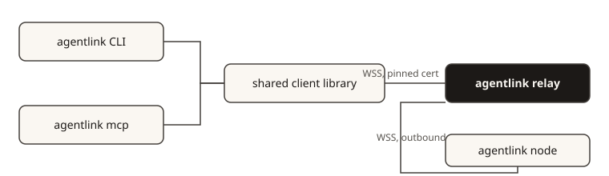
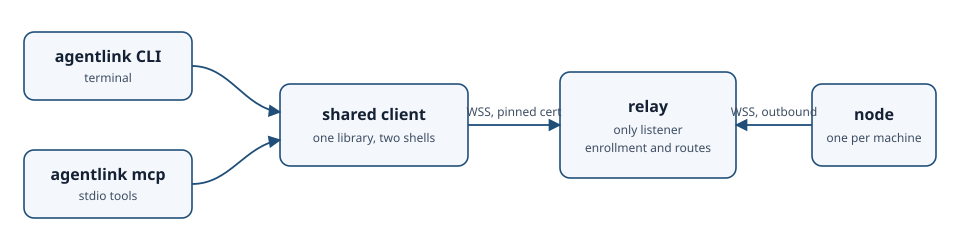
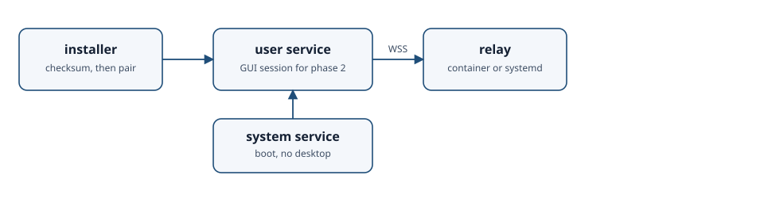

# agentlink

agentlink lets an AI agent, or you, use a Linux, Windows, or macOS machine that is sitting behind NAT. Each machine runs one small daemon. The daemon dials out to a relay you host. On Linux and macOS a single `agentlink` binary is the relay, the node, the CLI, the desktop controller (glibc/macOS builds), and an MCP server; on Windows `agentlink.exe` is the console CLI/daemon/relay and `agentlink-gui.exe` is the GUI-subsystem launcher for zero-console-flash Tray and Controller windows.





The relay is the only process that listens on a port. Nodes and clients both make outbound connections, so a machine behind NAT does not need a port forward.

Accounts, device login, sharing, and the browser Add-machine page are described in [docs/multi-user.md](docs/multi-user.md). SQLite is the default database and PostgreSQL is selected with `AGENTLINK_DATABASE_URL`; see [docs/deploy.md](docs/deploy.md). `agentlink login --user` is the same password flow the Android app uses. After that login, Act as node enrolls the phone under the account without a pairing token.

## What phase 1 does

- File operations: stat, list, read, write, mkdir, remove, move. `cat`, `write`, `cp`, and the MCP file tools use the fast binary-frame transfer path below. `cat` streams to stdout and `write` streams from stdin.
- Content search (regex or literal, glob include/exclude, `.gitignore`) and filename search.
- Precise edits: exact replace, line-range edit, and unified diff apply, written atomically.
- Filesystem watches. The CLI follows events; MCP polls them.
- Commands with streaming stdout and stderr, an exit code, a timeout, and cancel. Timeout and cancel kill the process group (Unix `-pgid` / Windows Job Object), including grandchildren.
- Background processes: start, list, incremental output, status, and kill.
- System info: OS, CPU, memory, disks, user, shell, a filtered environment, and detected tools.
- An interactive PTY (`portable-pty`, including Windows ConPTY). `agentlink shell` uses raw mode, UTF-8 carry buffering, bracketed paste, `~.` local disconnect escape, and resize when local stdin is a terminal.
- Fleet management: default node (`agentlink use` / `AGENTLINK_NODE`), local aliases (`agentlink alias`), TOFU pin management (`agentlink pin list|rm`), node rename/unpair (`agentlink nodes rename|rm`), unique ≥8-char ID prefix & case-insensitive name lookup, and `agentlink exec --all`.
- Pairing with an ed25519 node key and a one-time token or `agentlink-invite:v1:` string.
- TLS with a pinned self-signed certificate (or public-root trust). There is no unauthenticated mode.
- End-to-end sealed authorization: a relay login discovers and enrolls machines, while every file, shell, transfer, or desktop operation on a node requires an ed25519 `SignedGrant` verified against that node's local `owner-keys.json` and `revoked-grants.json`, intersected with its `--max-access` ceiling.
- A tamper-evident hash-chained JSONL audit log on the node (mode `0600`), with optional isolated relay (`node-audit.jsonl`) and S3 sinks. Handlers call `audit::submit(AuditEvent)`.
- `agentlink mcp` on stdio (UTF-8 BOM safe, deferred auth past `initialize`) or loopback Bearer HTTP for Cursor and Claude Desktop.

Phase 2 is screenshots, pointer and keyboard input, and the accessibility tree. A sealed client can use them after the node has a grant for that client's key. An account login is not that grant.

## Remote desktop

Phase 3 is a live desktop for a sealed native client (`agentlink controller` or the Android app). Picture bytes go peer-to-peer over WebRTC DTLS-SRTP after the node accepts a grant for that client. The browser does not open a desktop. `agentlink view` does not open a browser viewer, and `GET /view` serves a static notice.


A node reports whether it has a graphical session. A headless machine, such as a Linux server with no `DISPLAY` or `WAYLAND_DISPLAY`, has no desktop stream. The node also asks for consent before it answers an offer:

| `--stream-consent` | Behavior |
| --- | --- |
| `notify` (CLI default) | Allow, and try a non-blocking notification (`notify-send`, `osascript`, or built-in Windows WinRT toast / NotifyIcon) |
| `auto` | Allow with no notification |
| `prompt` | Wait asynchronously up to 30 seconds for `<data>/stream-consent/<id>.allow` or `.deny` (never silently downgraded to `notify`) |
| `deny` | Reject every offer |

A node library that never calls `configure_stream` denies offers. The CLI calls it.

Sessions append `stream_start` and `stream_stop` to the node `audit.log` (RFC3339 time, viewer, duration, frames, bytes). SDP is not logged. A `ScreenRecorder` in another crate can subscribe with `register_frame_tap` and receive `Started`, `Frame` (shared BGRA pixels plus dirty rectangles), and `Stopped`. This crate does not define `ScreenRecorder`. Capture stops when the last viewer leaves. Unchanged 64×64 tiles are not encoded.

### Capture

| OS | Session |
| --- | --- |
| Windows | DXGI Desktop Duplication (matched by `DeviceName`, reusable staging texture, split capture/HID/a11y workers). A timeout with no new frame is treated as unchanged. One-shot screenshots still fall back to GDI. |
| macOS | ScreenCaptureKit (cursor included, waits for real frame; split workers and mixed-DPI scaling). One-shot screenshots stay on CoreGraphics. If ScreenCaptureKit fails, the session falls back to repeating `CGDisplayCreateImage`. |
| Linux X11 | XShm. XDamage + XFixes when the server has them; otherwise tile hashes still drop a static desktop. |
| Linux Wayland | Screenshot portal. A glibc build that found `libpipewire-0.3` headers also maps the ScreenCast stream (dma-buf is copied once into BGRA, with persistent portal restore tokens). Set `AGENTLINK_DESKTOP_PIPEWIRE=0` to stay on the portal. |

`frame_interval` for audit recorders stays capped at 30 fps. Streams use `stream_interval`, capped at 60.

### Encode

Hardware first, in process where the OS allows it: VideoToolbox on macOS, a Media Foundation hardware transform on Windows (NVENC, Quick Sync, and AMF show up there). On Linux, ffmpeg is used for NVENC, QSV, VAAPI, or AMF only when the device node exists (`/dev/nvidia0` or `/dev/dri/renderD128`). A ffmpeg build that merely lists `h264_nvenc` is skipped. Frames wider than 1920 px are full-frame scaled before encoding rather than cropped. On hardware encoder failure, a 60-second cooldown tries ffmpeg `libx264` (`ultrafast` / zerolatency) before falling back to in-process `minih264` (public domain, baseline, no B-frames; not Cisco OpenH264). H.265 / AV1 use the matching ffmpeg encoder when present. WebRTC negotiates RTCP NACK and PLI, and bitrate adapts between the offer floor (down to 200 kbps) and 8 Mbps. A keyframe can be requested. Resolution is not changed mid-session.

### NAT

Host candidates (dual-stack IPv6 + IPv4 with automatic IPv4 fallback) are enough on a LAN. For a viewer on another network, run [coturn](https://github.com/coturn/coturn) yourself. agentlink does not embed a TURN server and the relay does not terminate TURN.

```
listening-port=3478
tls-listening-port=443
fingerprint
use-auth-secret
static-auth-secret=replace-with-AGENTLINK_TURN_SECRET
realm=agentlink
# Cap abuse if a short-lived credential leaks.
max-bps=2000000
bps-capacity=4000000
user-quota=2
total-quota=50
```

Prefer `turns:` on 443 (`turns:turn.example:443?transport=tcp`) so the media relay is TLS on a port that is usually open. Keep a public STUN server if you want reflexive candidates. The shared secret is `AGENTLINK_TURN_SECRET` on the relay, the same value as coturn `static-auth-secret`. Do not put a long-lived TURN password in the relay environment. `AGENTLINK_TURN_USERNAME` and `AGENTLINK_TURN_PASSWORD` are ignored on the relay.

On the relay process, set TURN when viewers connect across symmetric NAT. STUN has a default: if `AGENTLINK_STUN_URLS` is unset, `/view/config.json` lists public STUN servers (`stun:stun.l.google.com:19302`, `stun:stun1.l.google.com:19302`, and `stun:stun.cloudflare.com:3478`). Set the variable to replace that list, or set it to empty for host candidates only. TURN URLs are never filled in by default, and `/view/config.json` never includes a username or credential.

```bash
AGENTLINK_STUN_URLS=stun:turn.example:3478
AGENTLINK_TURN_URLS=turns:turn.example:443?transport=tcp
AGENTLINK_TURN_SECRET=replace-with-the-coturn-static-auth-secret
# optional, clamped to 5–15 minutes (default 600)
AGENTLINK_TURN_TTL_SECS=600
```

`GET /view/config.json` is unauthenticated and lists STUN plus TURN URLs only. `POST /api/ice` mints short-lived coturn REST credentials (`username` is `<expiry unix>:<user>`, `credential` is base64 HMAC-SHA1 of the secret, plus `ttl_secs`) for either an authenticated **`Authorization: Bearer <access_token>`** native client session or a logged-in dashboard cookie+CSRF (gated on callers with access to at least one node). **Both `agentlink controller` and the Android viewer automatically fetch ICE/TURN credentials from `POST /api/ice` on connect and refresh them automatically on `ice_restart`** (while still honoring explicit client-side `AGENTLINK_TURN_URLS` / `AGENTLINK_TURN_USER` / `AGENTLINK_TURN_PASS` and `AGENTLINK_STUN_URLS` overrides). On LANs with VPN overlays (`docker*`, `veth*`, `wintun`, `clash`, `warp`, etc.), the ICE layer prefers on-link physical host candidates without dropping fallback candidates. While WebRTC negotiates—or if ICE fails or drops—the native controller displays JPEG stills over the sealed `screenshot` invoke (`jpeg · relay`) and switches to `h264` only after a frame is decoded.

Live video and audio are WebRTC media: DTLS-SRTP between the native viewer (`agentlink controller` or Android) and the node. Browser desktop viewing is disabled (`GET /view` serves a static notice). Signaling, input when it goes through the relay, and the JPEG fallback stay on the sealed invoke path.

### Audio

Audio is optional G.711 µ-law (PCMU, 8 kHz, mono). On Linux the node shells out to `pw-record -P stream.capture.sink=true` or `parecord` when one of them is on `PATH`. If neither is there, the session stays video-only.

### What a 640×360 stream costs

These numbers are one `cargo test --release -p agentlink-desktop --lib stream::bench` run on a Linux build host. The frames are synthetic 640×360 BGRA. `minih264` was the encoder (no GPU). CPU time comes from `/proc/self/stat`, which counts in 10 ms ticks, so the percentages are coarse. This is damage plus encode, not viewer decode or LAN round trip.

| Scene | Encoded | Bytes | Bitrate over the simulated second | CPU | First access unit |
| --- | --- | --- | --- | --- | --- |
| Static desktop, 30 frames | 1 | 977 | ~7 kbps (the keyframe; later frames send nothing) | 10 ms, about 1% of one core | 1 ms |
| Typing, 30 frames, one pixel moves | 30 | 1,976 | ~15 kbps | 20 ms, about 2% of one core | 1 ms |
| Noisy video, 20 frames | 20 | 408,358 | ~4.9 Mbps | 30 ms, about 4% of one core | 1 ms |

### Android viewer

The phone client is the other offerer on this same `webrtc_signal` contract. `agentlink-view` opens a recvonly H.264 peer connection (with RTCP NACK/PLI, RTP sequence/timestamp depacketization, and `POST /api/ice` TURN auto-fetch + `ice_restart` credential refresh) and the data channels `input`, `cursor`, and `meta`. RTP is depacketized to Annex-B and decoded with Android `MediaCodec` (dynamically resizing on SPS/PPS changes, preferring hardware AVC with `OMX.google.*` / `c2.android.*` software fallback). Fullscreen desktop provides a collapsible floating keyboard/toolbar, long-press right-click, two-finger scroll, trackpad hover mode, metadata-aware cursor rendering, and clipboard sync. Pointer, keyboard, and loss feedback use the `input` channel when open, falling back to sealed `inject_input` when closed or for Android global actions.

Screenshot polling (serialized JPEG every ~700 ms) runs only when the offer is refused, the target is a phone node (`status: unavailable` / `fallback: screenshot`), no frame arrives in time, or the connection fails. A static desktop sends nothing after the keyframe; that silence is not a failure.

## Build

Rust 1.99.1 (pinned in `rust-toolchain.toml`). On Linux, install `pkg-config` and `libpipewire-0.3-dev` before building if you want PipeWire / GNOME Mutter ScreenCast streaming instead of the screenshot portal fallback.

```bash
cargo build --locked
cargo test --locked
```

Build the release binary with the default desktop `controller` feature (on Windows this builds both console `agentlink.exe` and GUI launcher `agentlink-gui.exe`):

```bash
cargo build --locked --release -p agentlink-cli
# target/release/agentlink (and target/release/agentlink-gui.exe on Windows)
```

For headless servers, containers, or relay-only hosts, disable the default `controller` feature to avoid GUI, OpenH264, and `libstdc++6` dependencies:

```bash
cargo build --locked --release -p agentlink-cli --no-default-features
```

Note on dependencies: `Cargo.toml` pins `launchbadge/sqlx` to the official PR #4502 merge commit (`10462fa4414c6c7f1ed1d39bb31678e3b726878c`) so `libsqlite3-sys =0.39.1` (bundled SQLite `3.54.1`, fixing `RUSTSEC-2026-0459`) can be linked before the next crates.io `sqlx` release. Offline builds should run `cargo vendor` beforehand. This repository does not include GitHub Actions workflows.

## Self-host quickstart (end-to-end)

### 1. Start the relay and rotate the bootstrap password

On a host that clients and nodes can reach:

```bash
agentlink relay --bind 0.0.0.0:7443 --data-dir /var/lib/agentlink
```

First start generates `cert.pem`, `key.pem`, `fingerprint.txt`, and—when the user database is empty—a one-time `bootstrap.password` (mode `0600`) for the `admin` account. Rotate that password immediately; doing so deletes `bootstrap.password`:

```bash
agentlink relay --data-dir /var/lib/agentlink user passwd admin
```

(Legacy `admin.token` bearer auth is disabled by default unless `AGENTLINK_LEGACY_ADMIN=1` and `AGENTLINK_LEGACY_ADMIN_TTL_SECS` are explicitly set; use account login + TOTP instead.)

The relay exposes `GET`/`HEAD /healthz` (`200 OK {"status":"ok"}`) for health checks. A self-signed relay is pinned with `sha256:…` from `fingerprint.txt`. That pin is not a secret: clients refuse any certificate that does not match it. A public certificate (for example Let's Encrypt behind nginx) should be verified with `--trust webpki` or `--fingerprint system`; see [docs/deploy.md](docs/deploy.md).

The same relay runs headless in Docker (`Dockerfile` builds `--no-default-features` with zero GUI/OpenH264/`libstdc++6` bloat and includes a `/healthz` `HEALTHCHECK`; `docker-compose.yml` publishes `7443` and mounts `relay-data` at `/var/lib/agentlink`):

```bash
docker compose up -d
docker compose exec relay agentlink relay --data-dir /var/lib/agentlink user passwd admin
```

On a host without Docker, `deploy/agentlink-relay.service` is a systemd unit for the same command. There is no built-in relay URL; pass `--relay` or `AGENTLINK_RELAY`.

### 2. Sign in and pair a node

From your operator/controller machine:

```bash
FP=$(cat /path/to/fingerprint.txt)   # or copy sha256:... from relay startup output
agentlink login \
  --relay wss://relay.example:7443 \
  --fingerprint "$FP" \
  --user admin

# Mint a one-time invite (bundles relay URL, trust/pin, and one-time pairing token):
agentlink pair --name laptop --access exec
```

On the machine you want to control (`laptop`):

```bash
agentlink node --invite 'agentlink-invite:v1:...' --name laptop
```

(Or install it as a background service directly with `install.sh --invite ...` / `install.ps1 -Invite ...`; see [Install a node](#install-a-node).)

The node writes its ed25519 identity into its data directory (`~/.local/share/agentlink/node` on Linux, `%APPDATA%\Agentlink\agentlink\data\node` on Windows) and bootstraps `grant-issuer.json` + `owner-keys.json`. Later starts reconnect without the invite.

### 3. Issue a node-local `SignedGrant`

Signing in to the relay **does not** authorize commands or desktop access on the node. Authorize your controller's ed25519 identity on the node:

```bash
# On the controller machine, print its public identity hex (`public_id`):
agentlink identity show

# On the node host (`laptop`), trust that controller key once (applied live, no restart):
agentlink grant trust-owner <controller-public-id-hex>

# Back on the controller machine, sign and store a time-bounded grant:
agentlink grant issue laptop --policy exec --ttl 1h

# Verify end-to-end execution:
agentlink exec laptop -- uname -a
```

Notes on multi-node grant management (see [docs/e2e-auth.md](docs/e2e-auth.md)):

- `--issuer auto` (default) uses a local node's `grant-issuer.json` **only** when the target `node_id` matches that local node's own `identity.json`. For remote nodes, it signs with your controller's operator identity (override with `--issuer operator|node` or `--issuer-data-dir <dir>`).
- Use `agentlink grant ensure --all --policy exec --ttl 1h` to ensure grants across online/pinned nodes, `agentlink grant refresh --all` to renew them, and `agentlink grant prune` to remove expired or wrong-grantee local grant files.
- To revoke a grant, run `agentlink grant revoke laptop --data-dir <node-data-dir>` **on the node host** (updates local `revoked-grants.json` with hot-reload; remote `Op::RevokeGrant` is rejected). `agentlink grant revoke-local` (`grant clear`) only deletes the controller's local grant file.
- For interactive approval without trusting the controller as an issuer, run `agentlink grant offer` on the controller and `agentlink grant paste` / `grant allow` on the node.

Optional limits on the node:

- `--max-access read-only` is the node's local ceiling (`read-only`, `read-write`, `exec`, `desktop`, `remote-view`, `remote-control`, or `full`; enrollment installers default to `exec`). A signed grant is intersected with it; the relay cannot raise it.
- `--root /path` confines all file, edit, tar-unpack, and transfer operations to that directory (with canonical symlink-chain checks and `O_NOFOLLOW`/reparse guards) and sets the default working directory for exec, background processes, and PTY sessions. It is not an OS sandbox: once `exec` or `full` is granted, commands run with the full privileges of the OS user running the node.

`agentlink perm laptop read-only` changes only the relay's routing preset. It does not change what the node will run.

## Install a node



Release archives, when you build them yourself, are named:

- Linux headless (static musl): `agentlink-<version>-x86_64-unknown-linux-musl.tar.gz` and `aarch64`
- Linux desktop (glibc with `controller` GUI): `agentlink-<version>-x86_64-unknown-linux-gnu.tar.gz` and `aarch64`
- Windows (dual-binary zip with `agentlink.exe` + `agentlink-gui.exe`): `agentlink-<version>-x86_64-pc-windows-msvc.zip` and `aarch64`
- macOS: `agentlink-<version>-universal-apple-darwin.tar.gz` (preferred) with fallback to `x86_64-apple-darwin` or `aarch64-apple-darwin`
- `SHA256SUMS` and `SHA256SUMS.minisig` over those archives

Linux and macOS (recommended `--invite` flow from `agentlink pair`):

```bash
curl -fsSL --proto '=https' --tlsv1.2 https://raw.githubusercontent.com/zltl/agentlink/main/install.sh | \
  env AGENTLINK_INVITE="agentlink-invite:v1:..." sh -s -- --name laptop
```

Pass `--desktop` on Linux to download the glibc GUI archive (`*-unknown-linux-gnu.tar.gz`), or `--headless` for the static musl archive and headless user service. You can also pass `--relay`, `--fingerprint`/`--trust`, and `AGENTLINK_PAIRING_TOKEN` explicitly instead of `--invite`.

Windows PowerShell (recommended `AGENTLINK_INVITE` flow; `iex` does not forward script arguments, so pass settings via environment variables):

```powershell
$env:AGENTLINK_INVITE = "agentlink-invite:v1:..."
irm https://raw.githubusercontent.com/zltl/agentlink/main/install.ps1 | iex
```

Or save and run with parameters:

```powershell
./install.ps1 -Invite "agentlink-invite:v1:..." -Name laptop
# Or with explicit relay + one-time pairing token:
./install.ps1 -Relay wss://relay.example:7443 -Fingerprint sha256:... -PairingToken $env:AGENTLINK_PAIRING_TOKEN -Name laptop
```

What `install.ps1` does on Windows:

- Enforces `https://` download URLs (rejects `http://` unless `-AllowInsecureHttp` / `AGENTLINK_ALLOW_INSECURE_HTTP=1` is explicitly set).
- Pre-checks `minisign` and verifies `SHA256SUMS.minisig` against the pinned key **before** downloading the archive.
- Extracts the zip via .NET `System.IO.Compression.ZipFile` with per-entry zip-slip path validation (safe on PowerShell 5.1).
- Gracefully stops any running `agentlink` tray or service before replacing `%LOCALAPPDATA%\agentlink\agentlink.exe`, and installs `agentlink-gui.exe` alongside it when present in the archive.
- Automatically appends `%LOCALAPPDATA%\agentlink` to User `PATH` (`HKCU:\Environment\Path`) and broadcasts `WM_SETTINGCHANGE` so new shells find `agentlink` immediately (opt out with `-NoPath` or `AGENTLINK_NO_PATH=1`).

Both installers default `--access` and `--max-access` to least-privilege `exec` (pass `--access full --max-access full` when desktop capture/control is desired). Both refuse to fetch `minisign.pub` from the release host, pre-check `minisign` before downloading, and point existing installs to `agentlink update --yes` (which verifies signatures in-process with the embedded key and does not require `minisign`). `AGENTLINK_CHECKSUM_ONLY=1` remains a break-glass override.

User scope installs under `~/.local/bin` or `%LOCALAPPDATA%\agentlink`. System scope uses `/usr/local/bin` or `%ProgramFiles%\agentlink` and needs an administrator. `--scope system`, `--auto-update`, `--desktop`, and `--headless` are optional.

## Background service

```bash
agentlink service install --invite 'agentlink-invite:v1:...' --name laptop

agentlink service status
agentlink service stop
agentlink service start
agentlink service restart
agentlink service logs
agentlink service uninstall
```

`--scope user` is the default, because a desktop phase has to run in the user's GUI session:

- Linux: a systemd user unit (`systemctl --user`) wanted by `graphical-session.target`. It starts with the graphical session and stops when that session ends (`PartOf=`). `PassEnvironment` forwards `DISPLAY`, `WAYLAND_DISPLAY`, `XAUTHORITY`, `DBUS_SESSION_BUS_ADDRESS`, and `XDG_RUNTIME_DIR` from the user manager. Install runs `systemctl --user import-environment` for whichever of those are set in the current shell, then restarts the node. `~/.config/autostart/agentlink-node.desktop` does that again at graphical login. `--headless` is wanted by `default.target` instead, with no GUI variables and no autostart entry.
- macOS: a LaunchAgent limited to the Aqua session. `--headless` drops that limit. `--scope system` is a LaunchDaemon and stays outside the GUI session.
- Windows: the tray in the signed-in session. `agentlink tray` puts an icon in the notification area and opens a small window (relay connection, account and pairing, start-on-login). Start-on-login is an HKCU `Run` value preferring sibling `agentlink-gui.exe` for zero console flash (with a `.lnk` Startup fallback if needed; no `.cmd` flash and no scheduled task or administrator required). `agentlink service install` (default user scope) registers that autostart and launches the tray. `--scope system` registers a Windows service in session 0 (cannot drive the desktop).

`--scope system` on Linux and macOS needs `--run-as` (validated username), or uses `SUDO_USER`. Do not install user scope as root. `agentlink service install --dry-run` prints the unit and a redacted `node.json` without contacting the relay. `--auto-update` also installs a daily task that runs `agentlink update --yes`.

## Windows dual-binary & tray

On Windows, Agentlink ships two binaries side by side in `%LOCALAPPDATA%\agentlink`:

- **`agentlink.exe`** (console subsystem): runs natively in PowerShell, `cmd.exe`, pipes, variable capture (`$x = & agentlink ls`), and interactive `agentlink shell` with primary command results on `stdout` and diagnostics on `stderr`.
- **`agentlink-gui.exe`** (Windows GUI subsystem): zero-console-flash launcher used automatically for background Tray (`agentlink tray --background`), start-on-login (`HKCU\...\Run`), and desktop Controller (`agentlink controller --background`) windows. Both binaries declare `PerMonitorV2` DPI awareness.

```powershell
agentlink tray
agentlink tray install
agentlink tray status
agentlink tray uninstall
```

`tray` with no subcommand opens the status window and a notification-area icon. Closing the window leaves the icon running. Quit is on the icon's right-click menu. `agentlink service stop` quits the tray cleanly.

The window shows connection state, relay URL (editable in Sign-In along with certificate trust), pairing status, and account. Sign in with your account password (and optional TOTP) to enroll via `enroll_self`, or paste an `agentlink-invite:v1:` string / pairing token.

## Desktop controller

Windows (`agentlink-gui.exe` / `agentlink controller`), macOS, and glibc Linux (`install.sh --desktop`) builds include a controller window with sign-in, machine list, terminal, file browser/editor, and live remote desktop:

```bash
agentlink controller
agentlink controller --background
agentlink controller --check
```

Sign-in displays the Relay URL field on fresh setup (pre-filled from `AGENTLINK_RELAY` when set; nothing hardcoded), username, password, and optional TOTP. Each machine has Terminal, Files, and Desktop:

- **Terminal**: Alacritty-core VT grid with bracketed-paste ESC/C1-CSI sanitization, European AltGr & `Ctrl+Shift+C/V` handling, debounced resize, and opt-in `OSC 52`.
- **Files**: editable path bar/breadcrumbs, native Upload & Download, Delete confirmation, unsaved-changes guard, and read-only preview for binary or >256 KiB files so large/binary files are never silently truncated.
- **Desktop**: live H.264 over WebRTC with automatic `POST /api/ice` TURN credential fetch & refresh, BT.601 color conversion, cached scaled cursor sprites, resolution/scale selector, View↔Control toggle, connect-seeded toggleable clipboard sync, explicit ungrab chord (`Right Ctrl` / `Ctrl+Alt+Shift`), and sealed JPEG fallback while ICE negotiates.
- **Grants**: per-node `SignedGrant` status + TTL badge (with grantee verification) and in-app identity display / grant import.

Live H.264 decode uses OpenH264 compiled from source (`BSD-2-Clause`; see `NOTICE` and `THIRD_PARTY.md`) into desktop builds. If that decoder does not start, the window stays on JPEG. `agentlink controller --check` prints `controller: ready` when compiled in and exits without opening a window.

## Update this binary

```bash
agentlink update --check
agentlink update --yes
agentlink update --auto
agentlink update --disable-auto
```

`update` checks release metadata first on `--check` (without downloading the full archive), preserves your platform artifact flavor on Linux (`gnu` desktop vs `musl` headless), persists `repo`/`download_base` in `update.json`, and verifies `SHA256SUMS` + `SHA256SUMS.minisig` in-process without needing an external `minisign` binary. The build-time embedded project pin (`deploy/minisign.pub`) takes priority over ambient disk files unless `--pubkey`, `AGENTLINK_UPDATE_PUBKEY`, or explicit `update.json` overrides it.

On Unix, the replacement uses an exclusive temp file (`O_CREAT|O_EXCL`) and a single atomic `rename`, then restarts active node services via a detached post-exit helper. On Windows, the updater stops any running tray/service gracefully, swaps `agentlink.exe` (and `agentlink-gui.exe` if present in the archive) via `cmd /D /C`, relaunches the tray/service, and cleans up temporary `.new`/`.cmd` files.

## CLI

Commands that talk to a node use the saved login session (or `--identity` for tokenless registered agent keys, or explicit `--relay`/`--fingerprint`/`--token`). Primary output goes to `stdout`; warnings and progress stay on `stderr`. `--json` prints structured JSON on `stdout`. Node arguments accept exact IDs, unique ≥8-char case-insensitive ID prefixes, case-insensitive names, or local aliases.

```bash
# Fleet & node addressing
agentlink ls                              # paired machines (stdout)
agentlink status                          # node names, human TTLs, grantee check, refreshable session
agentlink use laptop                      # set default node (also AGENTLINK_NODE)
agentlink alias set l laptop              # local short alias (alias set|ls|rm)
agentlink pin list                        # list TOFU node pins
agentlink pin rm laptop                   # clear pin after intentional node rebuild
agentlink nodes rename laptop work-lap    # rename a paired node
agentlink nodes rm old-box                # unpair/remove a node
agentlink exec --all --online -- uname -a # fan out across online nodes

# Grants (node-local E2E authorization)
agentlink grant issue laptop --policy exec --ttl 1h [--issuer auto|operator|node]
agentlink grant ensure --all --policy exec --ttl 1h
agentlink grant refresh --all
agentlink grant list
agentlink grant prune                     # delete expired / wrong-grantee local grant files
agentlink grant revoke laptop --data-dir <node-data-dir>   # node-local deny-list (on node host)
agentlink grant revoke-local laptop       # remove local controller grant file only

# Files, edits, exec, PTY, watch, desktop
agentlink ls laptop /tmp                  # directory on a node
agentlink exec laptop -- uname -a         # program + args
agentlink exec laptop --shell -- 'echo hi && uname -a'
agentlink cat laptop /etc/hostname
agentlink write laptop /tmp/note.txt --content "hello"
agentlink cp ./local.txt node://laptop/tmp/local.txt
agentlink cp node://laptop/tmp/local.txt ./local.txt
agentlink mkdir laptop /tmp/demo --parents
agentlink rm laptop /tmp/note.txt
agentlink mv laptop /tmp/a /tmp/b
agentlink shell laptop                    # raw PTY when stdin is a terminal (~. disconnects)
agentlink shell laptop --line            # line-oriented fallback
agentlink search laptop 'fn main' . --include '*.rs'
agentlink find laptop '*.rs' .
agentlink replace laptop note.txt 'old text' 'new text'
agentlink edit-lines laptop note.txt 1 3 $'replacement\n'
agentlink patch laptop /tmp --file change.diff
agentlink watch laptop /tmp --timeout-secs 30
agentlink bg laptop start --shell -- echo hello
agentlink bg laptop list
agentlink sysinfo laptop
agentlink screenshot laptop --out screen.jpg
agentlink screenshot laptop --target region --x 0 --y 0 --width 200 --height 100 --format png
agentlink click laptop 100 200
agentlink click laptop 10 10 --to-x 80 --to-y 40
agentlink type laptop "hello"
agentlink key laptop ctrl+c
agentlink scroll laptop --dy 3
agentlink ui-tree laptop
agentlink ui-act laptop mock:ok --op click

# Registered tokenless agent identities, approvals & audit
agentlink client create bot --out ./bot.identity.json
agentlink client grant <id> laptop read-only
agentlink grant issue laptop --grantee <bot-pubkey-hex> --policy read-only --ttl 1h
agentlink --identity ./bot.identity.json ls
agentlink approve list
agentlink audit query --sink local --op exec --verify
agentlink audit config set capture.diff true
agentlink audit sink add bucket --kind s3 --data logs,recordings \
  --endpoint http://127.0.0.1:9000 --bucket audit --path-style --credentials env
```

`agentlink exec` exits with the remote status code. In `--json` mode the command's stdout is inside the JSON document, not mixed with it.

`node://laptop/tmp/a` means `/tmp/a`, `node://laptop/./note.txt` or `node://laptop/~/note.txt` resolves relative/home paths on `--root` nodes, and Windows paths keep their drive (`node://laptop/C:/Users/me/a.txt`). Malformed URIs like `node://laptop` return an error instead of being treated as local filenames.

## Fast transfer

`agentlink cp` copies a file or a directory, including between two nodes.

```bash
agentlink cp ./project node://laptop/tmp/project
agentlink cp node://laptop/tmp/project ./project
agentlink cp node://laptop/tmp/a.bin node://desktop/tmp/a.bin
agentlink cp ./big.bin node://laptop/tmp/big.bin --compress off
```


What the copy does:

- Control messages stay JSON. Bulk file bytes travel as **E2E-encrypted WebSocket binary frames over the relay**, 1 MiB by default (`--chunk-size`, 64 KiB to 4 MiB), with E2E frame AAD v2 authenticating the full 40-byte frame header (`version`, `kind`, non-E2E `flags`, `offset`, `raw_len`, `request_id`).
- A sliding window (`--window`, default 8) keeps several chunks in flight, striped across ranges (`--parallel`, default 4). Each chunk carries its offset, so a file transfer can resume from a confined, no-follow partial file beside the destination.
- BLAKE3 skips a file that is already identical. A changed file at least 128 KiB sends an rsync-style block delta (Adler32 plus a BLAKE3 prefix) computed via streaming block signatures (bounded memory). Files larger than 256 MiB are sent whole.
- Chunks are zstd when that shrinks them (`--compress auto|on|off`). Auto skips images, archives, video, and other already-compressed types, and stops trying after an incompressible chunk.
- A directory is staged in a private `0700`/`0600` temp file as one tar stream of changed files and unpacked with canonical per-entry + post-unpack symlink-chain confinement (`serve_push_dir_confined`) and `& 0o777` mode masking.
- Direct QUIC P2P transfer is **currently disabled / planned** until E2E-sealed direct P2P lands (`--no-direct` is currently a no-op because relay transport is always used). For node-to-node copies, the initial peer handshake uses a bounded 12-second timeout (canceling on timeout before falling back to a private local-temp relay bridge).

`--progress` (`auto`, `on`, or `off`; `--progress` alone is `on`) prints bytes done / total, percent, throughput, and ETA on stderr. `--json` writes only the final JSON object to stdout; progress stays on stderr.

The MCP tool `copy_path` takes `direction` (`upload`, `download`, or `peer`), `node`, `path`, and `local` or `dst_node` plus `dst_path`.

`cat` and `write` use the same relay binary frames, window, and zstd path. `cat` writes stdout as each in-order chunk arrives; `cat --json` stops after 1 MiB and sets `truncated`. `write` streams stdin or `--content` chunk by chunk and sends the BLAKE3 hash at EOF. MCP `read_file` defaults to `64 KiB` (up to `1 MiB`) and supports `offset`, `max_bytes`, and `start_line`/`end_line` pagination. MCP `write_file` sends its argument through the same stream.

## MCP

`agentlink mcp` speaks newline-delimited JSON-RPC on stdin/stdout (stripping leading UTF-8 BOM on Windows pipes and also accepting `Content-Length` headers). Logs go to stderr. `initialize` and `tools/list` always succeed even before login; unauthenticated tool calls return structured setup errors instead of crashing with EOF.

`agentlink mcp --http 127.0.0.1:7337 --mcp-token "$AGENTLINK_MCP_TOKEN"` serves streamable HTTP on loopback only by default (`--allow-remote-http` is required for non-loopback binds), enforcing Bearer auth with minimum token length/entropy, 401 rate limiting, `Transfer-Encoding: chunked`, `202 Accepted` on JSON-RPC notifications, and localhost `Origin` checks.

Cursor (`~/.cursor/mcp.json` or `.cursor/mcp.json`, after running `agentlink login --user ...` and `agentlink grant issue ...` on this machine):

```json
{
  "mcpServers": {
    "agentlink": {
      "command": "/absolute/path/to/agentlink",
      "args": ["mcp"]
    }
  }
}
```

(If you use an explicit config directory or registered tokenless agent identity instead of the default user config, pass `"AGENTLINK_CONFIG_DIR"` or `"AGENTLINK_RELAY"` + `"AGENTLINK_FINGERPRINT"` + `"AGENTLINK_IDENTITY"` in `"env"`.)

Claude Desktop uses the same shape:

- macOS: `~/Library/Application Support/Claude/claude_desktop_config.json`
- Windows: `%APPDATA%\Claude\claude_desktop_config.json`
- Linux: `~/.config/Claude/claude_desktop_config.json`

Tools:

| Tool | Purpose |
| --- | --- |
| `get_status` | Local controller identity, relay session state, and grant summary |
| `list_machines` | Paired nodes, online flag, effective policy, and per-node `grant_status` / `grant_expires_in_secs` |
| `list_dir` | Directory listing |
| `stat_path` | One path |
| `read_file` | Fast-path byte/line range (`offset`, `max_bytes` default 64 KiB up to 1 MiB, optional `start_line`/`end_line`) |
| `write_file` | Fast-path upload of `content` or `content_base64` |
| `mkdir` | Create a directory |
| `remove_path` | Delete a file or, with `recursive`, a tree |
| `move_path` | Rename on the same node |
| `copy_path` | File or directory upload, download, or node-to-node copy (supports into-directory resolution) |
| `run_command` | `command` (shell) or `argv` (no shell). Output is capped at 1 MiB |
| `search_content` | Regex or literal content search, with globs, context, and pagination |
| `search_files` | Filename glob or regex |
| `replace_text` | Exact replace (`replace_all` optional). Fails unless the match is unique or `replace_all` is set |
| `edit_lines` | Replace a 1-based inclusive line range |
| `apply_patch` | Unified diff, relative to `root` |
| `watch_start` / `watch_poll` / `watch_stop` | Filesystem events. Poll because MCP is request/response |
| `process_start` / `process_list` / `process_output` / `process_status` / `process_kill` | Detached commands. Kill stops the process group |
| `system_info` | OS, CPU, memory, disks, user, shell, filtered env, detected tools |
| `terminal_open` / `terminal_write` / `terminal_read` / `terminal_resize` / `terminal_close` | Poll-based PTY |
| `screenshot` | Image content plus a short summary (`target`: `screen`, `monitor`, `region`, `window`, `monitors`; `format`: `jpeg`, `png`, `webp`) |
| `click` | Move, click, or drag (`to_x` / `to_y`, or `move_only`) |
| `type` | Unicode text |
| `key` | A combo such as `ctrl+c` |
| `scroll` | Positive `dy` scrolls up |
| `get_ui_tree` | Compact accessibility tree: role, name, bounds, id |
| `act_on_element` | `click`, `focus`, or `set_value` on an id from the tree |

Mutating/side-effecting tools (`run_command`, `write_file`, `remove_path`, `move_path`, `apply_patch`, `replace_text`, `edit_lines`, `click`, `type`, `key`, `process_start`, `act_on_element`) are never blindly auto-retried on connection close.

`run_command`, `process_*`, and `terminal_*` require `exec`. Search, watch, and `system_info` need `read`. Edits need `write`. `screenshot` requires `allow_desktop` or `remote-view`. `inject_input` requires `allow_desktop` or `remote-control`.

## Security model

See [SECURITY.md](SECURITY.md) and [docs/e2e-auth.md](docs/e2e-auth.md) for the full trust model. Key properties:

- **Transport & relay pinning**: TLS 1.2+ (rustls, ring) with leaf SHA-256 pin, SPKI/intermediate pin, OS trust store (`--fingerprint system`), or Mozilla roots (`--trust webpki`). CA-only trust warns because a public CA does not bind a node name to its ed25519 id.
- **Node-name pinning (TOFU)**: The first successful node list pins each name to its ed25519 id in `node-pins.json`. Mismatches fail closed until intentionally cleared via `agentlink pin rm <name-or-id>` (or Android Settings).
- **Relay auth & principals**: Typed principals (`Admin`, `Operator`, `Agent`, `Web`) enforce strict least privilege (agent keys cannot call `UserPasswd` or `SetPolicy`). Legacy `admin.token` is disabled by default (`AGENTLINK_LEGACY_ADMIN=1` + positive TTL required). TOTP replay state (`last_totp_step`) is persisted in the DB; refresh-token reuse revokes the device session family.
- **Fail-closed E2E**: `Invoke`, `Cancel`, `Session` (cursor updates), and relay-path `Transfer` frames are fail-closed sealed (`X25519` contributory check + `ed25519` transcript + `ChaCha20-Poly1305`, zeroized on drop). Unsealed plaintext data responses and cross-node responses are dropped; unverified `E2eHello` handshakes are isolated in a bounded 64-slot/30s LRU. E2E frame AAD v2 authenticates full 40-byte binary frame headers.
- **Connection-bound relay routes**: Every relay route tracks `(origin_conn_id, target_conn_id)` so no third-party client or node can inject into or terminate another tenant's route.
- **Node-authoritative grants & unified lifecycle**: Every node op and transfer requires a valid ed25519 `SignedGrant` verified against local `owner-keys.json` and `revoked-grants.json` (intersected with `--max-access`). Replay logs, cursors, cancels, PTYs, background processes, watches, TCP tunnels, and desktop streams are all bound to `(owner_peer, grant_jti, grant_exp_unix)` and torn down on revocation, expiry, or disconnect.
- **Path confinement & guardrails**: `--root` confines all file, edit, tar-unpack, and transfer operations using canonical symlink-chain checks, `O_NOFOLLOW`/reparse guards, and `& 0o777` mode masking. `limits.json` and `confirm.toml` (covering Unix and Windows destructive presets, edits, and transfer writes) are operational guardrails—not an OS sandbox.
- **Private storage & S3 CSE**: Secret files, temp transfer archives, and audit logs use atomic `0700`/`0600` creation permissions. Client-side S3 encryption (`client_key_env`) fails closed when `AGLKCSE1` is absent and binds `{bucket}/{key}` in AES-256-GCM AAD.
- **WebRTC & privacy**: WebRTC video/audio use DTLS-SRTP; browser viewing is disabled (`GET /view` notice, `POST /api/view-ticket` returns `410 Gone`). Input audit logs do not store typed text previews or key names. Clipboard sync runs only in `remote-control` sessions and is seeded on connect.
- **Rate limits & headers**: Login, refresh, signup, WebSocket connect, and `POST /api/ice` are rate-limited per IP. `/audit*` and HTTP responses carry full security headers (`CSP`, `X-Frame-Options: DENY`, `X-Content-Type-Options: nosniff`, `Cache-Control: no-store`).

### Audit

Handlers call `agentlink_node::audit::submit(AuditEvent)`. The node serializes sequence numbering, blob storage, hash-chain calculation, local JSONL (`0600`), and redacted/rotated `audit.log` under a single lock so concurrent operations never fork the chain.

Each kept record is canonical JSON with a BLAKE3 hash over `prev || newline || json-without-hash`. `agentlink audit query --verify` strictly verifies the full chain (including mid-chain start hashes and rejecting `"hash":"off"` entries).

Sinks fan out (`logs`, `diffs`, `recordings`). Configure them in `audit.toml` or with `agentlink audit sink add|ls|rm`:

| Kind | What it stores |
| --- | --- |
| `local` | `data_dir/audit/logs/YYYY-MM-DD.jsonl`, diffs and outputs under `audit/blobs/`, recordings under `audit/recordings/` (mode `0700`/`0600`) |
| `relay` | Gzipped batches (capped in size/rate, server-pinned `node_id`) stored in isolated `node-audit.jsonl` (separate from the relay's `audit.jsonl` auth chain; both `0600` and size-rotated). Query with `--sink relay`. Read-only page at `https://<relay>/audit`. |
| `s3` | Any S3-compatible API (AWS S3, MinIO, R2, OSS, COS). Object key `{prefix}/{node_id}/{yyyy}/{mm}/{dd}/{kind}/{session}/{seq}.jsonl.gz`. Optional `client_key_env` AES-256-GCM CSE (fail-closed, key-bound AAD). |

`agentlink audit query` reads `--sink local`, `--sink relay`, or `--sink s3`. Filters: `--node`, `--agent`, `--op`, `--since`, `--until` (accepting relative/ISO-8601/unix timestamps), `--text`, `--follow`, `--json`, `--verify`.

Presets are `minimal`, `standard`, `full`, and `paranoid`. `agentlink audit config show|set|preset` edits `audit.toml`; `--push <node>` pushes the policy to a remote node without clobbering local `audit.toml`.

## Layout

| Crate | Role |
| --- | --- |
| `agentlink-core` | Protocol, E2E framing/AAD v2, permissions, TLS pin, ICE/TURN fetch, transfer engine, client |
| `agentlink-relay` | Typed principals, accounts/TOTP, connection-bound routing, `/healthz`, `/api/ice`, dashboard |
| `agentlink-node` | Confined file/search/edit/watch/exec/PTY/tunnel handlers, grant lifecycle, audit pipeline |
| `agentlink-desktop` | Screenshot, input, accessibility, capture, encode, consent, clipboard, WebRTC sender |
| `agentlink-view` | WebRTC receiver, H.264 depacketizer/FrameBus, ICE/TURN refresh |
| `agentlink-cli` | `agentlink` console binary (optional `controller` feature) + Windows `agentlink-gui` launcher |
| `agentlink-ffi` | UniFFI node and client used by the Android app |

Control messages are JSON text frames on `wss://<relay>/v1/connect` (protocol version 2). Bulk file bytes travel as E2E-encrypted WebSocket binary frames on the control socket. Picture and audio bytes are WebRTC DTLS-SRTP media.

## Tests & local verification

Run the full local verification script (shell/PowerShell syntax checks, release matrix verification, workspace check & tests, UniFFI binding drift check if built, and `cargo audit` if installed):

```bash
sh scripts/verify.sh
```

Or run Cargo tests and the manual CLI+MCP smoke script directly:

```bash
cargo test --workspace
bash scripts/smoke.sh
```

- `agentlink-core`: unit, property, authz/redaction, E2E AAD v2, sandbox confinement, confirm/glob, and relay-port tests.
- `agentlink-relay`: SQLite/PostgreSQL account, TOTP replay, refresh-family revocation, route isolation, multi-tenant audit, `/api/ice` Bearer, `/healthz`, and dashboard tests.
- `agentlink-node`: integration, capabilities, desktop, transfer, and security tests (E2E fail-closed, replay-log isolation, `--root` symlink confinement, grant revocation teardown).
- `agentlink-desktop` & `agentlink-view`: tile damage, encoder fallback, consent, clipboard seeding, dual-stack ICE, H.264 depacketizer/FrameBus DPB integrity, and WebRTC loopback tests.
- `agentlink-cli`: CLI/MCP/controller/tray/service/update tests, `smoke.rs`, `deploy.rs`, `relay_startup.rs`, and `install_signature.rs`.
- `agentlink-ffi` & `android/`: FFI roundtrip/security tests and Robolectric/JVM unit tests (`./gradlew :app:testDebugUnitTest`).

## Android

The `android/` app speaks protocol version 2 through `agentlink-ffi` (UniFFI, `cargo-ndk`, `arm64-v8a`, `armeabi-v7a`, `x86_64`). One phone can act as a node or a controller client.


**Node.** The phone dials out under an Android 15-compatible foreground service (`remoteMessaging` with `onTimeout` handling and `START_NOT_STICKY`), exposes isolated `app:/files` and `app:/cache` (`node-cache/`, separated from controller temp files), optional SAF folders (`saf:/<id>/…` with revoke UI) or all-files access (`storage:/`), enforces E2E `SignedGrant` + `owner-keys.json` + consent ceiling across both invokes and file transfers, binds PTYs/background processes/watches/shell sessions to `(owner_peer, grant_jti, grant_exp_unix)`, and runs the same hash-chained audit pipeline.


**Client.** Sign in with your relay URL (visible on first launch), username, password, and optional TOTP. Manage TOFU node pins, controller public key, grants, and devices in Settings / Machine Hub; browse files with OS-aware roots (`/` on Unix, `C:/` on Windows, `app:/` on Android) plus server `find`/`search`/`audit`; keep PTY sessions across pane switches and in-place token refreshes (TrueColor + emoji + sticky `Ctrl`/`Alt`); and stream live H.264 desktop with automatic `POST /api/ice` TURN credentials, fullscreen toolbar/gestures, and clipboard sync.


Build the native library (auto-detects host library extension and newest NDK; use `android/build-native.ps1` on Windows), then the APK:

```bash
./android/build-native.sh
cd android && ./gradlew testDebugUnitTest assembleDebug assembleRelease
```

## Limitations

- The relay is trusted for enrollment, coarse operation class, and availability. It cannot read sealed payloads or forge a node-local `SignedGrant`, and pin mismatches fail closed.
- Approval text and forwarded audit records (`forward.central`) are cleartext at the relay by design. Turn off `forward.central` to keep audit records local (and on any CSE-encrypted S3 sink).
- The 40-byte file-frame header (request id, offset, flags) is visible to the relay for routing, while authenticated against tampering via E2E frame AAD v2; the payload is encrypted.
- Direct QUIC P2P file transfer is currently disabled / planned until E2E-sealed direct P2P lands; bulk file transfers use the sealed relay WebSocket path.
- Command allow/deny lists, `confirm.toml`, and `--root` are operational guardrails, not an OS container or kernel sandbox. Once `exec` or `full` is granted, commands run with the OS user's privileges.
- A directory copy stages a private temp tar before sending it; delta hashing streams with a 256 MiB threshold (larger files transfer whole).
- Resolution does not change mid-session in live desktop streams; audio capture on Linux requires `pw-record` or `parecord`.
- Windows and macOS release binaries are not Authenticode-signed or Apple-notarized yet, so SmartScreen / Gatekeeper may prompt on first launch.
- The relay Docker container runs as a non-root `agentlink` user; a root-owned bind mount of `/var/lib/agentlink` is not writable.

## Next

1. E2E-sealed direct QUIC P2P file transfer with TLS channel binding and verified peer grant enforcement.
2. An in-process `libei` client for Wayland sessions that should not round-trip input through the portal.
3. Mid-session resolution scaling under sustained packet loss.
